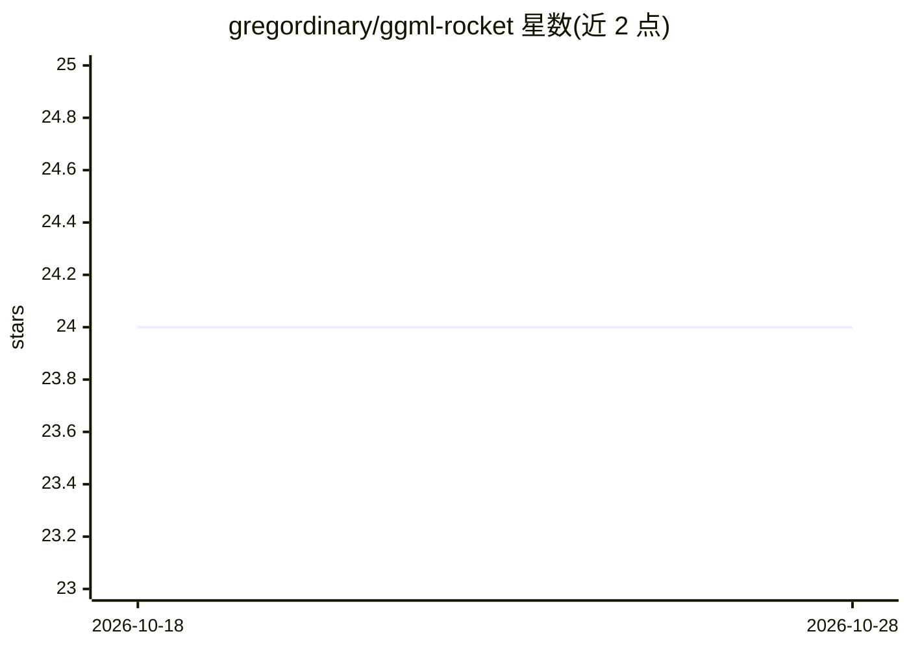

# gregordinary/ggml-rocket

⭐ 24 · C++ · GPL-3.0 · 推送 2026-10-13 · [GitHub](https://github.com/gregordinary/ggml-rocket) · 个人维护

**面向 Rockchip NPU 的 ggml 后端：为 llama.cpp/whisper.cpp 卸载 prefill**

以可运行时加载的 libggml-rocket.so 形式提供的 ggml 后端，接入原生 llama.cpp、whisper.cpp 等 ggml 宿主：设置 GGML_BACKEND_PATH 后 NPU 作为 ggml 设备出现。它通过主线 rocket DRM 加速驱动将 LLM 与 Whisper 的 prefill（含批量 GEMM、MoE 专家、注意力）卸载到 RK3588 NPU（RK3576 为第二目标，走 int8 W8A8 路线），decode 保留在 CPU。README 声明该项目主要由 AI（Claude）开发，且不保证质量与更新频率。需源码编译，并依赖 rocket-userspace 驱动库。

## 筛选速览

| 维度 | 判定 | 备注 |
|---|---|---|
| AI 角色 | `ai-ecosystem` | LLM/agent 周边工具 |
| 许可风险 | `viral` | GPL-3.0 |
| 部署形态 | `None` |  |
| 模型依赖 | local-ok | 支持本地模型 |
| 硬件要求 | — | 无带数字的原话,不猜 |
| 安装摩擦 | `medium` | 含编译或系统依赖之一 |
| 成熟度 | `idea` | |

## 能力要点

- 运行时加载的 libggml-rocket.so 直接嵌入原生 llama.cpp/whisper.cpp 等 ggml 宿主
- 将 prefill/Whisper encoder/MoE 专家卸载到 RK3588 NPU，decode 留在 CPU
- RK3576 为第二目标，走 int8 W8A8 路线（需 ROCKET_INT8=1）
- 提供 int8/int4/bf16 可选数据通路与 ROCKET_* 配置项

## 适用场景

- 在 RK3588 开发板上加速本地 LLM 的长提示词处理（降低首 token 等待）
- 加速 whisper.cpp/transcribe.cpp 的语音编码阶段
- 在内存受限的单板机上运行 MoE 模型的 prefill

## 场景标签

`推理引擎` · 领域:训练与推理

## 证据(README 行号)

> L12: A drop-in ggml backend for Rockchip NPUs (validated on
> L16: It builds as a runtime-loadable `libggml-rocket.so` that drops into stock llama.cpp,
> L17: whisper.cpp, and other ggml-based hosts (e.g. transcribe.cpp, a multi-model STT library): point

## 星数曲线

2026-10-18 24 → 2026-10-28 24（+0）

---
*卡片 v1 · prompt 1.4 · 生成 2026-10-27 · 置信度 high · 依据 README sha `c3c53f5d5adb` · [字段定义](../../DATASET.md)*
