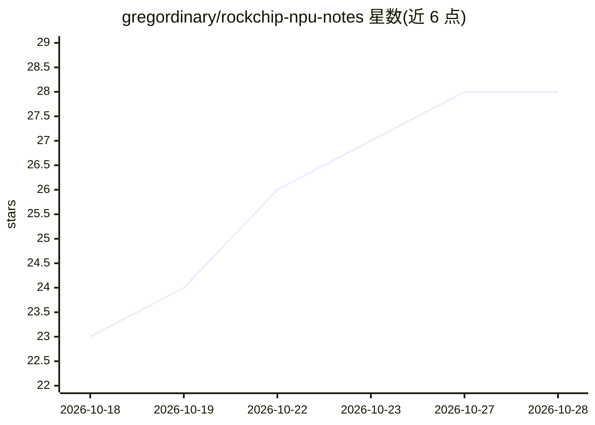

# gregordinary/rockchip-npu-notes

⭐ 28 · Shell · CC-BY-4.0 · 推送 2026-10-13 · [GitHub](https://github.com/gregordinary/rockchip-npu-notes) · 个人维护

**RK3588 NPU 硬件与 regcmd 寄存器接口的逆向研究笔记集**

面向直接编程 Rockchip RKNPU（NVDLA 衍生设计）的开发者文档：描述 RK3588 三核 NPU 的硬件块结构（CNA→CORE→DPU 流水线、CBUF、寄存器分段）、rocket DRM accel 驱动的四个 uAPI ioctl 与 regcmd 任务模型、matmul 以 1×1 卷积实现的机制。记录六种数据类型能力、硬件 sweep 实测吞吐（~460 GOP/s）、十个已知硬件问题（E1-E10）及规避方法，并含 RK3576/RK3566 逐 SoC 差异表与移植指南。文档由 AI（主要为 Claude）撰写，准确度不做保证。

## 筛选速览

| 维度 | 判定 | 备注 |
|---|---|---|
| AI 角色 | `ai-knowledge` | 知识聚合/清单类 |
| 许可风险 | `viral` | CC-BY-4.0 |
| 部署形态 | `None` |  |
| 模型依赖 | — | README 未给出锁定关系 |
| 硬件要求 | — | 无带数字的原话,不猜 |
| 安装摩擦 | `low` | 无编译、无系统依赖或容器化 |
| 成熟度 | `idea` | |

## 能力要点

- 覆盖 rocket 驱动 uAPI 四个 ioctl 与 regcmd 任务模型
- 十个经硬件 sweep 验证的已知问题（E1-E10）及软件规避方法
- RK3588/RK3576/RK3566 逐 SoC 参数、寄存器图与移植模式
- matmul-as-conv 机制与 tile 布局编码说明

## 适用场景

- 通过 rocket 驱动直接给 RK3588 NPU 写寄存器程序
- 把 RK3588 的结论移植到 RK3576 等其他 Rockchip SoC
- 排查 NPU 任务输出错误或挂起时对照已知问题清单
- 为 LLM prefill 在 NPU 上调优时查找性能结论

## 场景标签

 · 领域:嵌入式硬件/AI 加速器文档

## 证据(README 行号)

> L3: These notes describe the hardware blocks and the register-command interface of the Rockchip
> L5: `rocket` DRM accel driver. They are for developers who program the NPU directly, through `rocket` or another raw
> L16: Most of this content applies to every Rockchip SoC that integrates the RKNPU, an NVDLA-derived

## 星数曲线

2026-10-18 23 → 2026-10-28 28（+5）

---
*卡片 v1 · prompt 1.4 · 生成 2026-10-26 · 置信度 high · 依据 README sha `f50e421c1006` · [字段定义](../../DATASET.md)*
