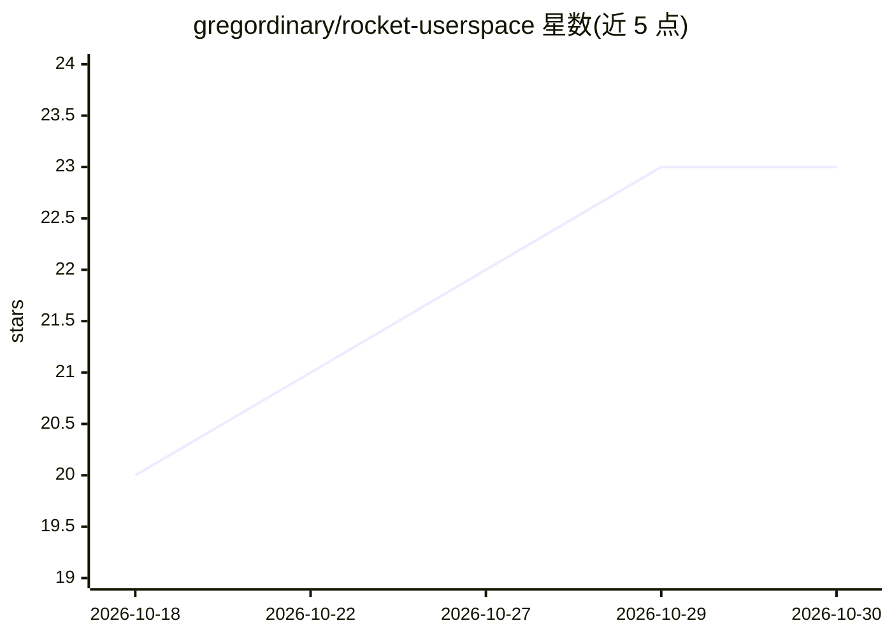

# gregordinary/rocket-userspace

⭐ 23 · C · GPL-3.0 · 推送 2026-10-13 · [GitHub](https://github.com/gregordinary/rocket-userspace) · 个人维护

**面向 Rockchip NPU 的用户态驱动与 matmul/算子库（RK3588/RK3576）**

构建在主线 rocket DRM-accel 驱动之上的自包含 C 库 librocketnpu，分三层：/dev/accel/accel0 设备 shim、分块多核权重驻留 matmul、NPU 上算子库（卷积、池化、激活、Transformer/Whisper 原语、SigLIP/SAM/ModernBERT 常驻编码器）。RK3588 为完整验证目标，RK3576 运行增长中的子集。作为自定义 NPU 计算的底座，由 ggml-rocket 后端、tflite-rocket delegate 和 ort-rocket execution provider 链接使用。作者声明该项目主要由 AI（Claude）开发且不保证质量与更新频率。

## 筛选速览

| 维度 | 判定 | 备注 |
|---|---|---|
| AI 角色 | `ai-ecosystem` | LLM/agent 周边工具 |
| 许可风险 | `viral` | GPL-3.0 |
| 部署形态 | `None` |  |
| 模型依赖 | — | README 未给出锁定关系 |
| 硬件要求 | — | 无带数字的原话,不猜 |
| 安装摩擦 | `medium` | 含编译或系统依赖之一 |
| 成熟度 | `idea` | |

## 能力要点

- 三层结构：设备 shim + 多核 matmul + on-NPU 算子库，无 ML 框架依赖
- matmul 支持 fp16/int8/int4/bf16/tf32 及 int8 字节分解的 bit-exact int16
- 含 Transformer/Whisper 原语与 SigLIP、SAM、ModernBERT 权重驻留编码器
- Gemma-4-12B prefill 可经此路径在 NPU 上运行，decode 留在 CPU

## 适用场景

- 在 RK3588 板上为自定义 NPU 计算提供用户态底座
- 通过 ggml/tflite/ort 后端在 Rockchip NPU 上跑推理
- 对重复层做权重预打包以降低每次推理开销

## 场景标签

`推理引擎` · 领域:训练与推理

## 证据(README 行号)

> L12: A userspace driver, tiled/multicore matmul and on-NPU op library for Rockchip NPUs, built on
> L19: and runs on its own, as the substrate for custom NPU compute. The `ggml-rocket` ggml backend,
> L20: the `tflite-rocket` delegate and the `ort-rocket` execution provider link it.

## 星数曲线

2026-10-18 20 → 2026-10-30 23（+3）

---
*卡片 v1 · prompt 1.4 · 生成 2026-10-27 · 置信度 high · 依据 README sha `a0651cefe69f` · [字段定义](../../DATASET.md)*
