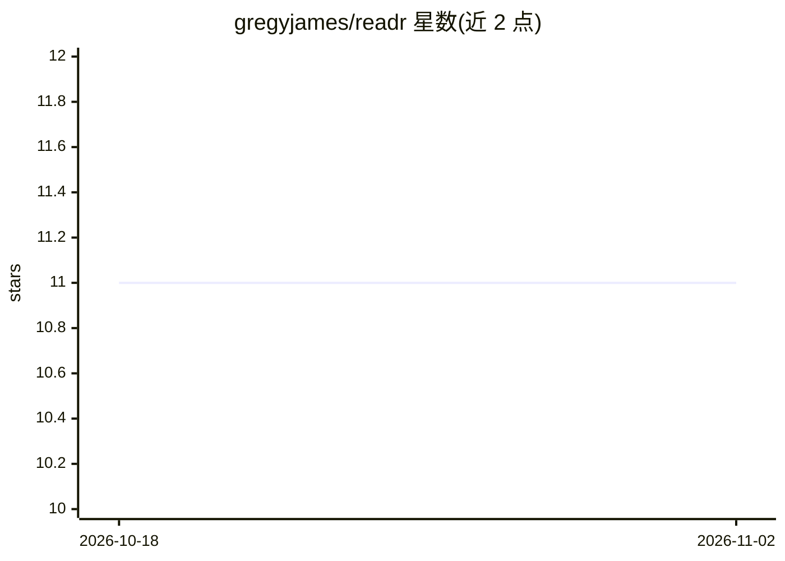

# gregyjames/readr

⭐ 11 · Go · MIT · 推送 2026-10-30 · [GitHub](https://github.com/gregyjames/readr) · [官网](https://hub.docker.com/r/gjames8/readr) · 个人维护

**自托管的 AI 稍后阅读与知识图谱应用**

基于 Go 后端与 Vue/Tailwind 前端的本地部署应用：将网页文章保存为磁盘上的 markdown 文件并用 SQLite 追踪。AI 部分包括通过 OpenRouter 模型对话查询阅读库（支持 @ 引用整篇喂入上下文）、自动生成 OKF YAML frontmatter、自动发现语义关联并注入 [[Wikilinks]] 的后台 agent，以及力导向知识图谱视图与 SSE 实时事件推送。数据以 markdown 本地存储，可与 Obsidian、Logseq 同步；支持站点级 Jinja 模板定制文章结构。以 Docker Compose 部署。

## 筛选速览

| 维度 | 判定 | 备注 |
|---|---|---|
| AI 角色 | `ai-native` | 本体是模型或模型工具 |
| 许可风险 | `permissive` | MIT |
| 部署形态 | `self-host` | docker 或自建部署 |
| 模型依赖 | locked-api |  |
| 硬件要求 | — | 无带数字的原话,不猜 |
| 安装摩擦 | `low` | 无编译、无系统依赖或容器化 |
| 成熟度 | — | 结构信号不足 |

## 能力要点

- OpenRouter 模型驱动的阅读库对话查询，@ 引用喂入全文
- 后台 agent 自动生成 OKF frontmatter 并注入语义 Wikilinks
- 全局/单篇力导向知识图谱与双向链接、悬浮预览
- 文章与聊天记录以本地 markdown 存储，可同步 Obsidian/Logseq

## 适用场景

- 自建稍后阅读服务并让 AI 帮我查询收藏的文章
- 把阅读积累整理成带语义链接的个人知识图谱
- 用 Obsidian 继续管理和同步阅读笔记

## 场景标签

`知识图谱` `知识库管理` · 领域:知识与检索

## 证据(README 行号)

> L5: A self-hosted, AI-native read-it-later app and knowledge graph engine powered by Vue, Tailwind, and Go. Articles are
> L8: * **AI-Native Chat**: Query your reading collection using OpenRouter models. Reference notes directly with `@` menti

## 星数曲线

2026-10-18 11 → 2026-11-02 11（+0）

---
*卡片 v1 · prompt 1.4 · 生成 2026-11-02 · 置信度 high · 依据 README sha `e20df58dcf6a` · [字段定义](../../DATASET.md)*
