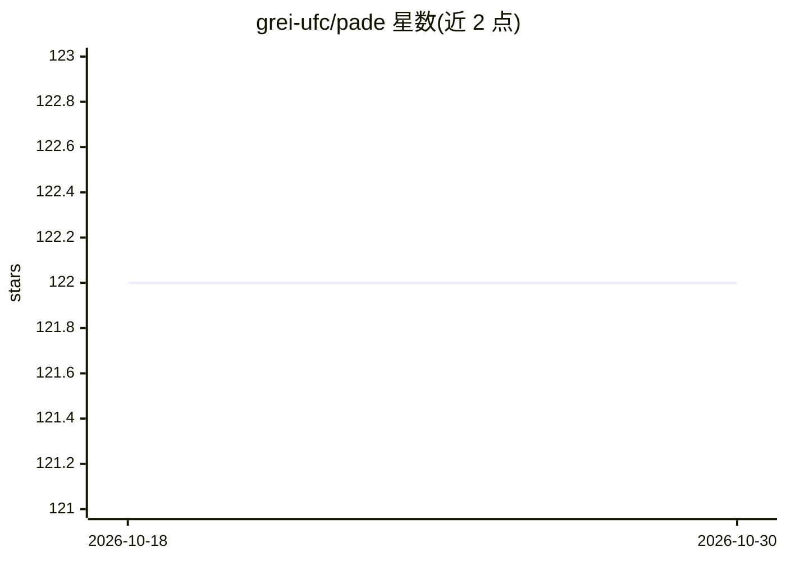

# grei-ufc/pade

⭐ 122 · Python · MIT · 推送 2026-05-08 · [GitHub](https://github.com/grei-ufc/pade) · 组织维护

**多智能体系统开发框架：分布式环境下的 agent 编写、执行与管理**

纯 Python 编写的多智能体系统框架，核心基于 Twisted，提供 AMS、Sniffer 服务与 pade start-runtime 命令行运行时，支持 FIPA-ACL 消息、CSV 日志（sessions/agents/messages/events）、JSON 配置启动、多进程多 agent 端口编排，以及 Mosaik API 3.0+ 电力系统联合仿真驱动。面向科研与工程开发者，最初由巴西塞阿拉联邦大学智能电网组开发，配套科学论文可引用。新版本移除 SQLite 依赖与内嵌 Flask 界面。

## 筛选速览

| 维度 | 判定 | 备注 |
|---|---|---|
| AI 角色 | `ai-ecosystem` | LLM/agent 周边工具 |
| 许可风险 | `permissive` | MIT |
| 部署形态 | `self-host` | docker 或自建部署 |
| 模型依赖 | — | README 未给出锁定关系 |
| 硬件要求 | — | 无带数字的原话,不猜 |
| 安装摩擦 | `low` | 无编译、无系统依赖或容器化 |
| 成熟度 | — | 结构信号不足 |

## 能力要点

- 基于 Twisted 的纯 Python 多智能体运行时，含 AMS/Sniffer 服务
- CSV 结构化日志系统替代原 SQLite 依赖
- pade start-runtime 支持 --num/--port 多进程多 agent 编排与 JSON 配置启动
- 重构 mosaik_driver 支持 Mosaik API 3.0+ 电力系统联合仿真

## 适用场景

- 编写并运行分布式多智能体仿真
- 电力系统联合仿真中作为智能体平台与 Mosaik 对接
- 通过 Sniffer 与 messages.csv 分析 agent 间 ACL 消息流量

## 场景标签

`多智能体` `Agent 框架` · 领域:Agent 开发

## 证据(README 行号)

> L5: PADE is a framework for developing, executing, and managing multi-agent systems in distributed computing environment
> L17: Python‐based multi‐agent platform for application on power grids

## 星数曲线

2026-10-18 122 → 2026-10-30 122（+0）

---
*卡片 v1 · prompt 1.4 · 生成 2026-10-23 · 置信度 high · 依据 README sha `e6016f33340f` · [字段定义](../../DATASET.md)*
