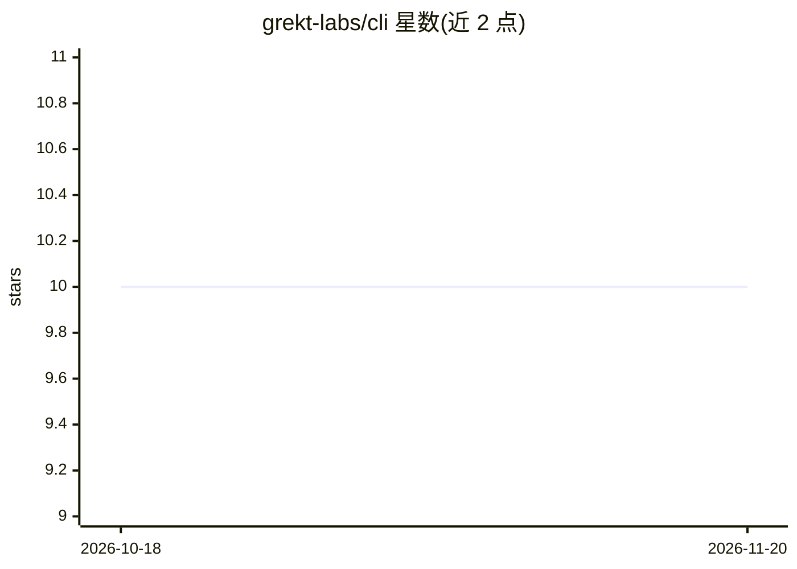

# grekt-labs/cli

⭐ 10 · TypeScript · NOASSERTION · 推送 2026-03-22 · [GitHub](https://github.com/grekt-labs/cli) · [官网](https://www.grekt.com) · 组织维护

**本地审计与同步 AI 工件（MCP/agent/技能）的 CLI**

本地优先的 AI 工具链基础设施：扫描、评估并管理项目中的 MCP 服务器、agent 配置、技能、hooks 与 commands 等工件，输出安全扫描结果与 PASS/FAIL/WARN 质量评级，支持锁定版本、pin 哈希、跨团队同步到 Claude Code、Cursor 等工具，无云依赖。通过 install.sh、Homebrew 或 npm 全局安装。源码采用 BSL 1.1 许可，禁止用于构建竞品，每个版本两年后转为 MIT。

## 筛选速览

| 维度 | 判定 | 备注 |
|---|---|---|
| AI 角色 | `ai-ecosystem` | LLM/agent 周边工具 |
| 许可风险 | `none` | NOASSERTION |
| 部署形态 | `library` | 以包/库形式分发 |
| 模型依赖 | — | README 未给出锁定关系 |
| 硬件要求 | — | 无带数字的原话,不猜 |
| 安装摩擦 | `low` | 无编译、无系统依赖或容器化 |
| 成熟度 | — | 结构信号不足 |

## 能力要点

- 扫描工件安全风险并给出 PASS/FAIL/WARN 质量评级
- 版本锁定、哈希 pin 与 lockfile 完整性/漂移检查
- 同步到 Claude Code、Cursor 等十余个工具及 agentskills.io 标准
- 工件来源支持自建 registry、公共 registry、GitHub/GitLab 仓库与本地路径

## 适用场景

- 安装技能/MCP 前先做安全审计
- 团队内同步经过验证的 AI 工具配置
- 检查项目内 AI 工件是否被篡改或漂移

## 场景标签

 · 领域:开发者工具/AI 工具链管理

## 证据(README 行号)

> L6: Local-first AI tooling infrastructure. Audit, manage, and secure MCPs, agents, skills, hooks, and commands across Cl
> L79: grekt syncs to Claude Code, Cursor, Windsurf, Cline, GitHub Copilot, Aider, Continue, OpenCode, Amazon Q, and any t

## 星数曲线

2026-10-18 10 → 2026-11-20 10（+0）

---
*卡片 v1 · prompt 1.4 · 生成 2026-11-19 · 置信度 high · 依据 README sha `f9657ae7f727` · [字段定义](../../DATASET.md)*
