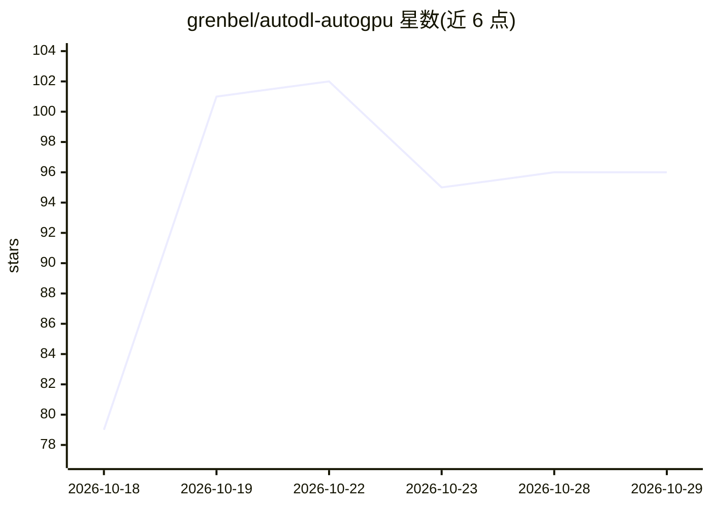

# grenbel/autodl-autogpu

⭐ 96 · Python · MIT · 推送 2026-10-07 · [GitHub](https://github.com/grenbel/autodl-autogpu) · 个人维护 · 中文 README

**让 Claude Code 自动开关 AutoDL GPU 实例的 agent 技能**

面向 Claude Code 的技能（skill）：用户用自然语言下达指令后，由 AI 通过浏览器操作 AutoDL 控制台开机（GPU/无 GPU 模式）、经 SSH 启动任务与关机，并在本地记录预算与用量账本。实例上部署独立守卫程序，每分钟检测 GPU/CPU/磁盘/网络使用，空闲达到配置时长即自动关机，即使对话中断也生效。开机前经过预算门检查；无空闲 GPU 时可等待或克隆到其他主机（默认关闭）。首次使用由 AI 引导完成 SSH 密钥、登录指令与预算等设置。当前版本面向 Claude Code，Codex 版本后续提供。

## 筛选速览

| 维度 | 判定 | 备注 |
|---|---|---|
| AI 角色 | `ai-ecosystem` | LLM/agent 周边工具 |
| 许可风险 | `permissive` | MIT |
| 部署形态 | `None` |  |
| 模型依赖 | — | README 未给出锁定关系 |
| 硬件要求 | — | 无带数字的原话,不猜 |
| 安装摩擦 | `low` | 无编译、无系统依赖或容器化 |
| 成熟度 | — | 结构信号不足 |

## 能力要点

- 自然语言指令驱动 AutoDL 实例开机、跑任务与关机
- 实例端空闲守卫：每分钟检测利用率，空闲自动关机，不依赖对话存活
- 开机前预算门与本地用量记账（元/GPU 小时）
- 无空闲 GPU 时可等待或自动克隆实例迁移任务（默认关闭）

## 适用场景

- 夜间训练结束后让实例自动关机，避免空转计费
- 自动化实验流程中由 AI 代为开机跑实验并记账
- 传数据时自动用无 GPU 模式降低费用

## 场景标签

`工作流自动化` · 领域:效率与自动化

## 证据(README 行号)

> L61: The current version is for Claude Code. A version for Codex will follow.
> L64: git clone https://github.com/grenbel/autodl-autogpu ~/.claude/skills/autodl-autogpu

## 星数曲线

2026-10-18 79 → 2026-10-29 96（+17）

---
*卡片 v1 · prompt 1.4 · 生成 2026-10-23 · 置信度 high · 依据 README sha `45e400293e16` · [字段定义](../../DATASET.md)*
