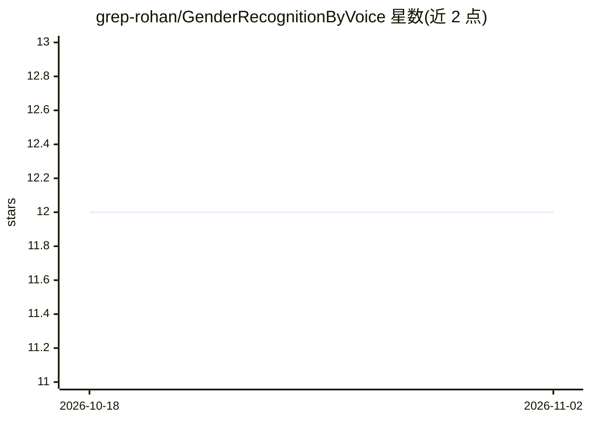

# grep-rohan/GenderRecognitionByVoice

⭐ 12 · Python · 推送 2025-11-07 · [GitHub](https://github.com/grep-rohan/GenderRecognitionByVoice) · 个人维护

**用机器学习从语音录音识别说话人性别的脚本集**

一套 Python 与 R 脚本，基于带标注的声学特征数据集 voice.csv 训练并评估多种分类器（k-NN、SVM、决策树、随机森林、MLP），支持保存训练好的神经网络模型。提供 CLI 菜单：可训练神经网络，或录制 20 秒语音样本，经 R 脚本 getAttributes.r 提取声学特征后预测性别。依赖 scikit-learn、pandas 等库与 R 的 warbleR 包；录制流程需麦克风与 pyaudio（可选）。仓库未附带显式开源许可证。

## 筛选速览

| 维度 | 判定 | 备注 |
|---|---|---|
| AI 角色 | `ai-native` | 本体是模型或模型工具 |
| 许可风险 | `none` | — |
| 部署形态 | `library` | 以包/库形式分发 |
| 模型依赖 | — | README 未给出锁定关系 |
| 硬件要求 | — | 无带数字的原话,不猜 |
| 安装摩擦 | `low` | 无编译、无系统依赖或容器化 |
| 成熟度 | — | 结构信号不足 |

## 能力要点

- 对比 k-NN/SVM/决策树/随机森林/MLP 五种分类器的训练与测试指标
- CLI 菜单支持录制 20 秒样本并输出预测性别
- 录制音频特征提取由 R 脚本 getAttributes.r（warbleR）完成
- 模型可持久化为 trained_neural_net 并显示损失曲线

## 适用场景

- 我想在标注语音数据集上训练并比较性别分类模型
- 我想录制一段自己的声音并得到性别预测
- 我想复用数据预处理与评估指标的脚本做声学分类实验

## 场景标签

 · 领域:音频/机器学习

## 证据(README 行号)

> L3: A collection of scripts for training and evaluating machine-learning models that classify a speaker's gender from sh

## 星数曲线

2026-10-18 12 → 2026-11-02 12（+0）

---
*卡片 v1 · prompt 1.4 · 生成 2026-11-01 · 置信度 high · 依据 README sha `cd56a2e270b7` · [字段定义](../../DATASET.md)*
