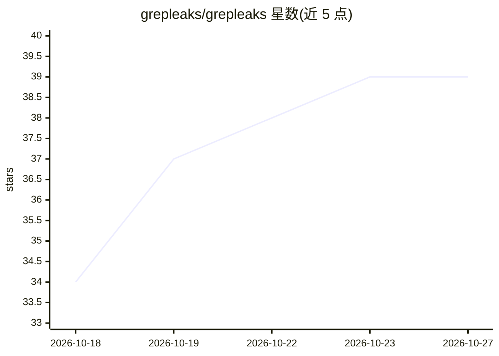

# grepleaks/grepleaks

⭐ 39 · TypeScript · NOASSERTION · 推送 2026-09-24 · [GitHub](https://github.com/grepleaks/grepleaks) · [官网](https://grepleaks.com) · 组织维护

**给安全测试人员的终端 AI 渗透测试 agent 与工具箱**

基于 OpenCode fork 与 OpenTUI 构建的终端 AI 渗透测试环境：对话式 agent 结合可检索的 Pentest Tools 目录（900+ 工具条目）与 Debian Linux Docker 工具箱，120+ 渗透测试技能提示，可在容器内按需安装附加工具，并在授权范围内执行侦察、分析并生成报告。模型接入支持 Grepleaks key（合作方 abliteration.ai 的无限制模型）或任意 OpenAI 兼容 API（需支持 tool calling）。通过安装脚本本地构建 Docker 镜像，提供主机 companion 执行宿主机命令（带权限确认）。README 自述处于早期预览阶段，完整 Docker 工作流仅在 macOS/Colima 下测试通过。

## 筛选速览

| 维度 | 判定 | 备注 |
|---|---|---|
| AI 角色 | `ai-native` | 本体是模型或模型工具 |
| 许可风险 | `none` | NOASSERTION |
| 部署形态 | `desktop` | 安装包/桌面程序 |
| 模型依赖 | — | README 未给出锁定关系 |
| 硬件要求 | — | 无带数字的原话,不猜 |
| 安装摩擦 | `low` | 无编译、无系统依赖或容器化 |
| 成熟度 | `idea` | |

## 能力要点

- 对话式 agent + 900+ 工具目录 + Debian Docker 工具箱，容器内按需装工具
- 支持 Grepleaks key（abliteration.ai 无限制模型）或任意 OpenAI 兼容 BYOK 接入
- 内置 host companion 可经权限确认在宿主机执行命令
- 动作默认需用户批准，engagement 文件经挂载工作区持久化

## 适用场景

- 在授权范围内让 AI agent 执行渗透测试侦察并产出报告
- 浏览安全工具目录后由 agent 选择并运行工具
- 分析扫描结果与 API 规格中的安全风险

## 场景标签

`网络安全` · 领域:学习与行业

## 证据(README 行号)

> L8:  An AI pentest agent that lives in your terminal.
> L18: Grepleaks brings a conversational agent, a searchable **Pentest Tools** catalog
> L39: |**Your model**|Start with the **Grepleaks key** (unrestricted models from our partner abliteration.ai), or connect

## 星数曲线

2026-10-18 34 → 2026-10-27 39（+5）

---
*卡片 v1 · prompt 1.4 · 生成 2026-10-25 · 置信度 high · 依据 README sha `95a629244341` · [字段定义](../../DATASET.md)*
