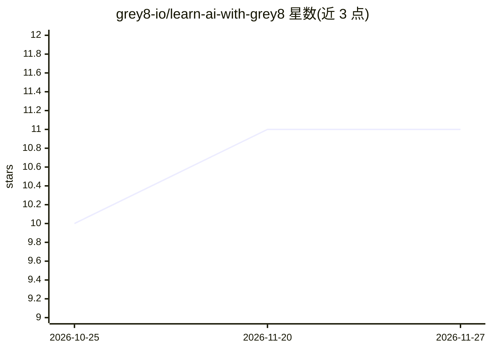

# grey8-io/learn-ai-with-grey8

⭐ 11 · Python · AGPL-3.0 · 推送 2026-10-13 · [GitHub](https://github.com/grey8-io/learn-ai-with-grey8) · [官网](https://grey8-io.github.io/learn-ai-with-grey8) · 组织维护

**本地 LLM 导师驱动的自学 AI 训练营（15 个项目、12 阶段）**

一个开源 AI 训练营课程：12 个阶段、35 节课、15 个实战项目，约 28 小时，内容从 Python 基础到部署 AI 应用。所有环节在本地运行，通过 Ollama 驱动苏格拉底式 LLM 导师，无需云端 API key；练习由真实测试（60%）加 AI 评分（40%）评定，进度自动保存并可跨设备同步。由 AI 人才培训公司 Grey8 维护，AGPL-3.0 许可，另有可选付费认证与企业培训服务。

## 筛选速览

| 维度 | 判定 | 备注 |
|---|---|---|
| AI 角色 | `ai-knowledge` | 知识聚合/清单类 |
| 许可风险 | `viral` | AGPL-3.0 |
| 部署形态 | `library` | 以包/库形式分发 |
| 模型依赖 | local-ok | 支持本地模型 |
| 硬件要求 | — | 无带数字的原话,不猜 |
| 安装摩擦 | `low` | 无编译、无系统依赖或容器化 |
| 成熟度 | — | 结构信号不足 |

## 能力要点

- 本地 Ollama 驱动的苏格拉底式 AI 导师，无需云 API key
- 12 阶段课程覆盖 Python、LLM、RAG、Agent 到部署
- 练习由真实测试（60%）+ AI rubric（40%）评分
- 进度追踪无需账号，登录可跨设备同步

## 适用场景

- 开发者想从零系统学习构建 AI 应用
- 团队负责人为成员提供免费 AI 技能培训路径
- 无云端 API 预算的本地学习环境搭建

## 场景标签

`教程课程` · 领域:学习与行业

## 证据(README 行号)

> L3: A self-driving, open-source AI bootcamp powered by a local LLM tutor -- learn by building 15 real projects, zero clo
> L5: **12 phases | 35 lessons | 15 projects | ~28 hours | 100% local**
> L50: |Phase|Focus|Lessons|What You Build|

## 星数曲线

2026-10-25 10 → 2026-11-27 11（+1）

---
*卡片 v1 · prompt 1.4 · 生成 2026-11-19 · 置信度 mid · 依据 README sha `7022330abc1d` · [字段定义](../../DATASET.md)*
