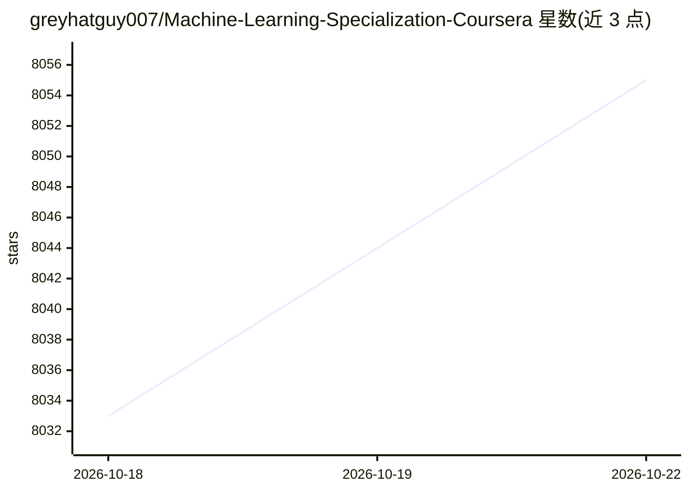

# greyhatguy007/Machine-Learning-Specialization-Coursera

⭐ 8,055 · Jupyter Notebook · MIT · 推送 2025-12-28 · [GitHub](https://github.com/greyhatguy007/Machine-Learning-Specialization-Coursera) · 个人维护

**吴恩达 Coursera 机器学习专项课程的作业解答与笔记汇编**

个人维护的课程学习仓库，收录斯坦福大学与 DeepLearning.AI 联合推出的 Machine Learning Specialization（2022，Andrew Ng 主讲）三门课程的练习测验要点、Optional Labs、编程作业解答与完成证书截图。内容按课程与周次组织：课程1覆盖线性/逻辑回归与正则化，课程2覆盖神经网络、TensorFlow 实现与决策树，课程3覆盖聚类、异常检测、推荐系统与深度 Q-Learning。仓库仅作参考学习用途，不提供可安装的软件。

## 筛选速览

| 维度 | 判定 | 备注 |
|---|---|---|
| AI 角色 | `ai-knowledge` | 知识聚合/清单类 |
| 许可风险 | `permissive` | MIT |
| 部署形态 | `None` |  |
| 模型依赖 | — | README 未给出锁定关系 |
| 硬件要求 | — | 无带数字的原话,不猜 |
| 安装摩擦 | `low` | 无编译、无系统依赖或容器化 |
| 成熟度 | — | 结构信号不足 |

## 能力要点

- 三门课程按周次组织的作业解答与 Optional Labs 笔记
- 涵盖回归、神经网络、决策树、推荐系统、深度 Q-Learning 等主题
- 包含 Lunar Lander 训练与电影推荐系统的成果演示

## 适用场景

- 学习该专项课程时对照参考作业实现
- 按主题查找经典机器学习算法的实践示例
- 了解课程整体内容结构再决定是否报名

## 场景标签

`教程课程` · 领域:学习与行业

## 证据(README 行号)

> L1: # Machine Learning Specialization Coursera
> L3: Contains Solutions and Notes for the Machine Learning Specialization by Andrew NG on Coursera

## 星数曲线

2026-10-18 8,033 → 2026-10-22 8,055（+22）

---
*卡片 v1 · prompt 1.4 · 生成 2026-10-20 · 置信度 high · 依据 README sha `edea1bfc509e` · [字段定义](../../DATASET.md)*
