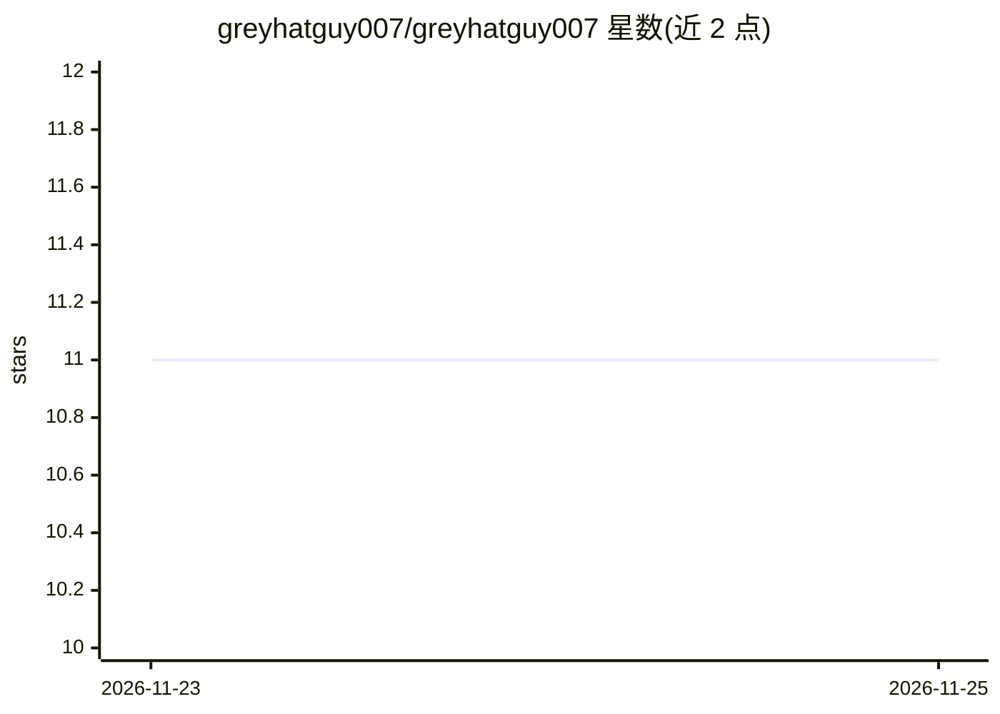

# greyhatguy007/greyhatguy007

⭐ 11 · 推送 2026-11-22 · [GitHub](https://github.com/greyhatguy007/greyhatguy007) · [官网](https://greyhatguy007.github.io/) · 个人维护

**个人 GitHub 主页的 README 配置文件**

该仓库为开发者个人资料配置，README 内容是 DevSecOps/SRE 工程师的自我介绍：当前工作为生产 Kubernetes 集群的 CI/CD 与安全流水线、CVE 修复与缓解；技能列表涵盖 Kubernetes、Helm、GitLab CI/CD、Prometheus 等运维工具与 Python、Go、Bash 等编程语言；另含博客、联系方式等外链。仓库不含代码、文档或可安装组件，仅用于渲染个人主页。

## 筛选速览

| 维度 | 判定 | 备注 |
|---|---|---|
| AI 角色 | `ai-knowledge` | 知识聚合/清单类 |
| 许可风险 | `none` | — |
| 部署形态 | `None` |  |
| 模型依赖 | — | README 未给出锁定关系 |
| 硬件要求 | — | 无带数字的原话,不猜 |
| 安装摩擦 | `low` | 无编译、无系统依赖或容器化 |
| 成熟度 | — | 结构信号不足 |

## 能力要点

- 个人主页 README 配置文件
- 列出 DevSecOps/SRE 技能栈与当前工作方向
- 提供博客、LinkedIn、邮箱等联系渠道

## 适用场景

- 展示 GitHub 个人资料主页
- 了解该作者的运维与安全背景

## 场景标签

 · 领域:个人资料/配置

## 证据(README 行号)

> L1: Ritvik Prasad
> L3:  DevSecOps Engineer / SRE · India · UTC+05:30
> L17: - Reliability & Ops — Kubernetes (GKE / RKE2), Helm, GitLab CI/CD, Loki, Prometheus, incident response & postmortem

## 星数曲线

2026-11-23 11 → 2026-11-25 11（+0）

---
*卡片 v1 · prompt 1.4 · 生成 2026-11-23 · 置信度 high · 依据 README sha `5773d695a3cb` · [字段定义](../../DATASET.md)*
