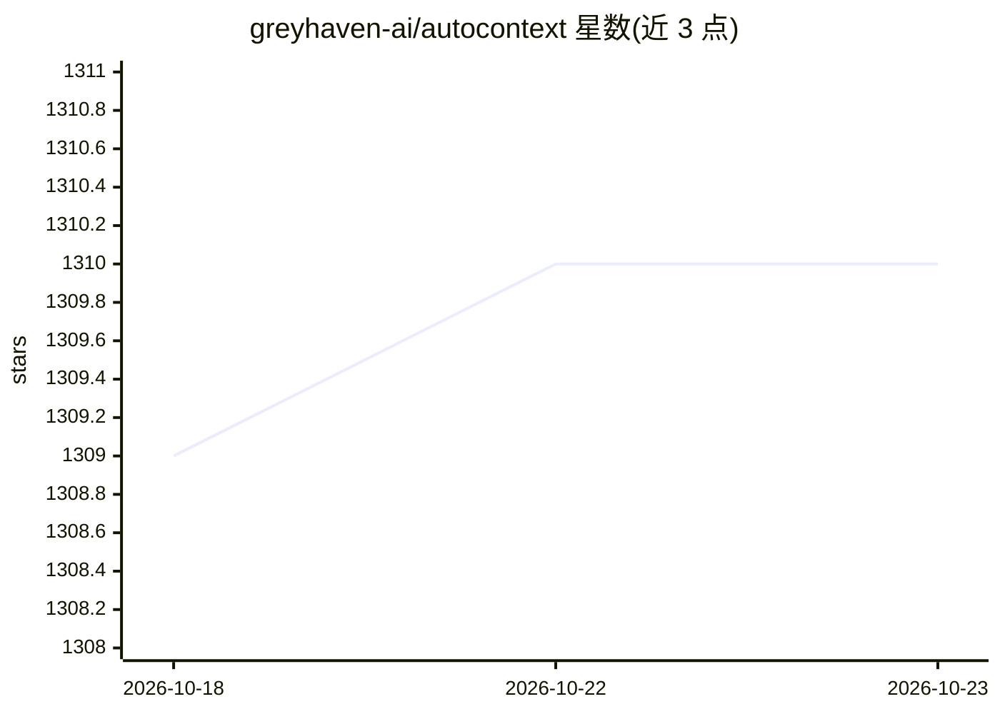

# greyhaven-ai/autocontext

⭐ 1,310 · Python · Apache-2.0 · 推送 2026-10-21 · [GitHub](https://github.com/greyhaven-ai/autocontext) · 组织维护

**面向 agent 的自改进运行框架：跑任务、评估、留存经验**

autocontext 是一个 agent 改进 harness：给定目标后，反复运行任务并对照评估，保留有用经验、淘汰无效路径，产出 trace、报告、playbook、数据集及可选的本地模型训练产物供下次运行使用。支持多种 agent provider（Pi、Anthropic、openrouter、claude-cli、codex 等），自托管可跑在 vLLM/Ollama 或任意 OpenAI 兼容端点上。以 Python 包（uv 安装）与 npm CLI（autoctx）分发，另提供 MCP serve 与 TUI。运行产物 filesystem-first，可检查、diff、回放或喂给训练；HTTP/WS 控制面默认仅绑 loopback。

## 筛选速览

| 维度 | 判定 | 备注 |
|---|---|---|
| AI 角色 | `ai-ecosystem` | LLM/agent 周边工具 |
| 许可风险 | `permissive` | Apache-2.0 |
| 部署形态 | `library` | 以包/库形式分发 |
| 模型依赖 | local-ok | 支持本地模型 |
| 硬件要求 | — | 无带数字的原话,不猜 |
| 安装摩擦 | `low` | 无编译、无系统依赖或容器化 |
| 成熟度 | — | 结构信号不足 |

## 能力要点

- 以目标驱动的迭代任务运行与评估循环，留存 lesson/playbook/数据集
- 多 provider 接入：Pi、Anthropic、openrouter、claude-cli、codex、pi-rpc 等
- 自托管路径支持 vLLM/Ollama/OpenAI 兼容端点，可生成本地模型训练产物
- 提供 MCP serve 工具面与操作员 TUI，运行产物 filesystem-first 可回放

## 适用场景

- 让 coding/任务 agent 在评估循环中迭代改进策略
- 把稳定行为蒸馏到更便宜的运行时模型
- 通过 MCP 把 autocontext 工具面暴露给 Claude Code 或 Cursor

## 场景标签

`Agent 框架` `模型评测` · 领域:Agent 开发

## 证据(README 行号)

> L11: autocontext is a harness for agent improvement. Give it a goal, it runs the task against evaluation, keeps the usef
> L38: Use `AUTOCONTEXT_AGENT_PROVIDER=anthropic`, `openai-compatible`, `openrouter`, `claude-cli`, `codex`, `pi-rpc`, or 

## 星数曲线

2026-10-18 1,309 → 2026-10-23 1,310（+1）

---
*卡片 v1 · prompt 1.4 · 生成 2026-10-21 · 置信度 high · 依据 README sha `9a3aefe503cd` · [字段定义](../../DATASET.md)*
