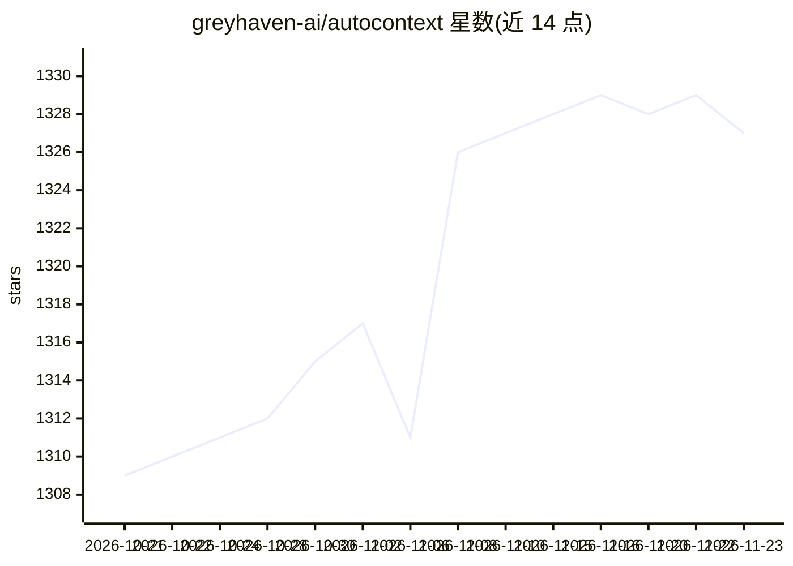

# greyhaven-ai/autocontext

⭐ 1,327 · Python · Apache-2.0 · 推送 2026-11-18 · [GitHub](https://github.com/greyhaven-ai/autocontext) · 组织维护

**帮助 agent 迭代改进任务的递归自我改进 harness**

面向 agent 的改进 harness：给定目标后针对评估运行任务，保留有效经验、丢弃无效路径，为后续运行留下 trace、报告、playbook、数据集及可选的本地模型训练产物。以 Python CLI/库与 TypeScript CLI 发布，支持 Pi、Claude Code、Cursor、Hermes 等 agent 入口及 MCP 服务；提供 run/status/watch/investigate/train 等 CLI 面，结果以文件系统优先的形式存储、diff 与回放。Qwen 权重复现与 GPU 执行标注为待完成。

## 筛选速览

| 维度 | 判定 | 备注 |
|---|---|---|
| AI 角色 | `ai-ecosystem` | LLM/agent 周边工具 |
| 许可风险 | `permissive` | Apache-2.0 |
| 部署形态 | `library` | 以包/库形式分发 |
| 模型依赖 | local-ok | 支持本地模型 |
| 硬件要求 | — | 无带数字的原话,不猜 |
| 安装摩擦 | `medium` | 含编译或系统依赖之一 |
| 成熟度 | — | 结构信号不足 |

## 能力要点

- 递归改进循环：针对评估运行任务并沉淀 playbook/数据集/trace 等产物
- 多 agent 接入：Pi、MCP（Claude Code/Cursor）、Hermes 技能导出
- 支持 vLLM、Ollama 等自托管端点及本地 hosting/capability 声明
- train 命令将稳定行为蒸馏为更低价 runtime

## 适用场景

- 让 agent 在迭代中保留有效经验并跨 run 复用
- 通过 MCP 将改进工具面接入自己的 agent 客户端
- 在自托管 vLLM/Ollama 端点上运行完整改进循环

## 场景标签

`模型评测` · 领域:评测与运维

## 证据(README 行号)

> L11: autocontext is a harness for agent improvement. Give it a goal, it runs the task against evaluation, keeps the usef
> L70: Use `AUTOCONTEXT_AGENT_PROVIDER=anthropic`, `openai-compatible`, `openrouter`, `claude-cli`, `codex`, `pi-rpc`, or 
> L145: |`serve mcp`|`autoctx serve mcp`|Give an agent the autocontext tool surface|

## 星数曲线

2026-10-21 1,309 → 2026-11-23 1,327（+18）

---
*卡片 v1 · prompt 1.4 · 生成 2026-11-23 · 置信度 mid · 依据 README sha `a289be3dc68f` · [字段定义](../../DATASET.md)*
