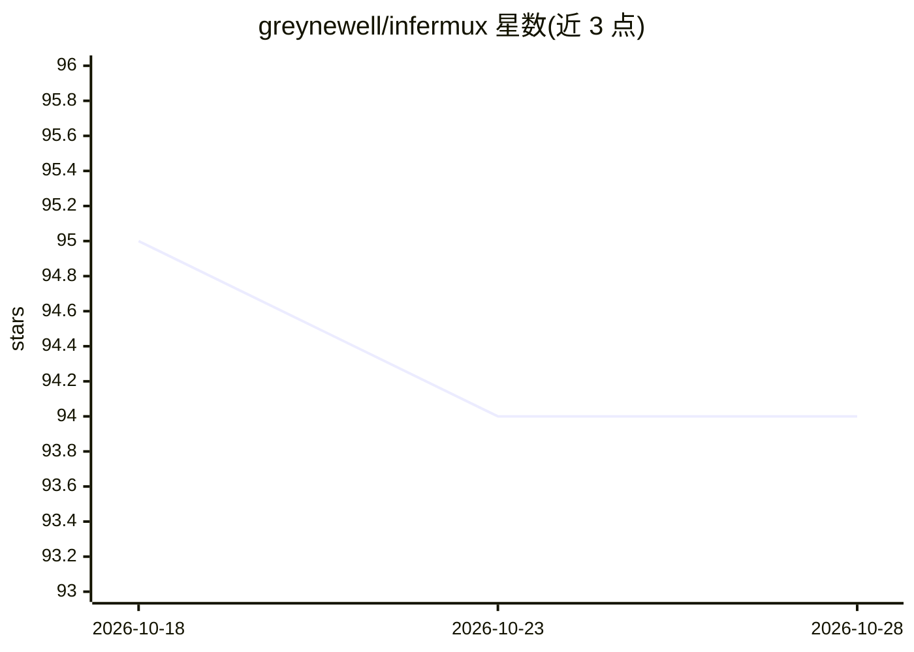

# greynewell/infermux

⭐ 94 · Go · MIT · 推送 2026-07-03 · [GitHub](https://github.com/greynewell/infermux) · [官网](https://infermux.dev) · 个人维护

**Go 推理路由器：跨多个 provider 分发 LLM 推理请求并追踪成本**

用 Go 编写的推理路由器，属 MIST 技术栈组成部分。核心是 Provider 接口（Name/Models/Infer），将 OpenAI、Anthropic 等 provider 注册进 Registry 后按模型路由；每次请求记录 token 数与成本，并向 TokenTrace 上报 span。同时提供 HTTP 与 gRPC 两种 API，gRPC 服务端内置健康检查、server reflection、keepalive、panic recovery、优雅退出；客户端对 UNAVAILABLE 做最多 3 次指数退避重试并传播调用方 deadline。附带 CLI 可启动服务或直接发起推理。

## 筛选速览

| 维度 | 判定 | 备注 |
|---|---|---|
| AI 角色 | `ai-ecosystem` | LLM/agent 周边工具 |
| 许可风险 | `permissive` | MIT |
| 部署形态 | `None` |  |
| 模型依赖 | — | README 未给出锁定关系 |
| 硬件要求 | — | 无带数字的原话,不猜 |
| 安装摩擦 | `low` | 无编译、无系统依赖或容器化 |
| 成熟度 | — | 结构信号不足 |

## 能力要点

- Provider 接口抽象与按模型注册路由
- HTTP 与 gRPC 双 API，同一路由器两种暴露方式
- 按请求追踪 token 与成本，向 TokenTrace 上报 span
- gRPC 客户端瞬态失败重试与 deadline 传播，含全链路集成测试

## 适用场景

- 在多个推理 provider 间做统一路由与负载分发
- 为 LLM 应用接入层集中记录 token 成本与链路追踪
- 以 HTTP 或 gRPC 服务形式对外提供推理入口

## 场景标签

`模型网关` · 领域:Agent 开发

## 证据(README 行号)

> L3: Inference router. Part of the MIST stack.
> L17: type Provider interface {
> L33: Tracks tokens and cost per request. Reports spans to TokenTrace.

## 星数曲线

2026-10-18 95 → 2026-10-28 94（-1）

---
*卡片 v1 · prompt 1.4 · 生成 2026-10-23 · 置信度 high · 依据 README sha `3c65f58a34b5` · [字段定义](../../DATASET.md)*
