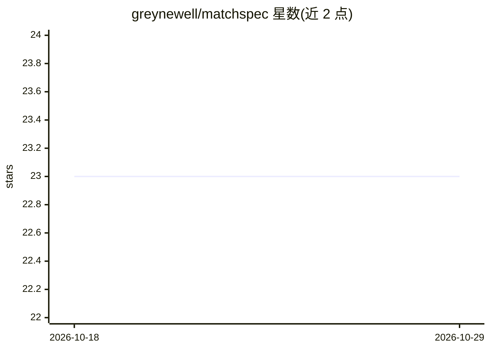

# greynewell/matchspec

⭐ 23 · Go · MIT · 推送 2026-02-17 · [GitHub](https://github.com/greynewell/matchspec) · [官网](https://matchspec.dev) · 个人维护

**Go 语言的评测框架：定义预期结果并运行测试**

Go 编写的 eval 框架，属于 MIST 栈的组成部分。用户以 SuiteRegistry 注册测试套件，通过 Runner 对推理函数（inferFunc）执行评测，用 exact、contains、prefix、suffix 四种匹配器判定输出是否正确，输出通过状态与分数。提供 HTTP API（ingest/run/suites/results 端点）与 CLI（eval、serve 命令）两种运行方式。以 go get 安装为 Go 库，MIT 许可。

## 筛选速览

| 维度 | 判定 | 备注 |
|---|---|---|
| AI 角色 | `ai-ecosystem` | LLM/agent 周边工具 |
| 许可风险 | `permissive` | MIT |
| 部署形态 | `None` |  |
| 模型依赖 | — | README 未给出锁定关系 |
| 硬件要求 | — | 无带数字的原话,不猜 |
| 安装摩擦 | `low` | 无编译、无系统依赖或容器化 |
| 成熟度 | — | 结构信号不足 |

## 能力要点

- Suite 注册 + Runner 运行的评测流程，输出 passed 与 score
- 四种匹配器：exact、contains、prefix、suffix
- HTTP API 提供 /mist /eval /suites /results 端点
- CLI 支持 matchspec eval 与 serve 命令

## 适用场景

- 为模型或推理函数编写可自动判定的评测套件
- 通过 HTTP 服务对外提供评测执行与结果查询
- 在 CI 或脚本中以 CLI 运行套件评测

## 场景标签

`模型评测` · 领域:评测与运维

## 证据(README 行号)

> L1: # matchspec
> L3: Eval framework. Part of the MIST stack.
> L28: runner := matchspec.NewRunner(reg, inferFunc, reporter)

## 星数曲线

2026-10-18 23 → 2026-10-29 23（+0）

---
*卡片 v1 · prompt 1.4 · 生成 2026-10-27 · 置信度 high · 依据 README sha `b18d959515e7` · [字段定义](../../DATASET.md)*
