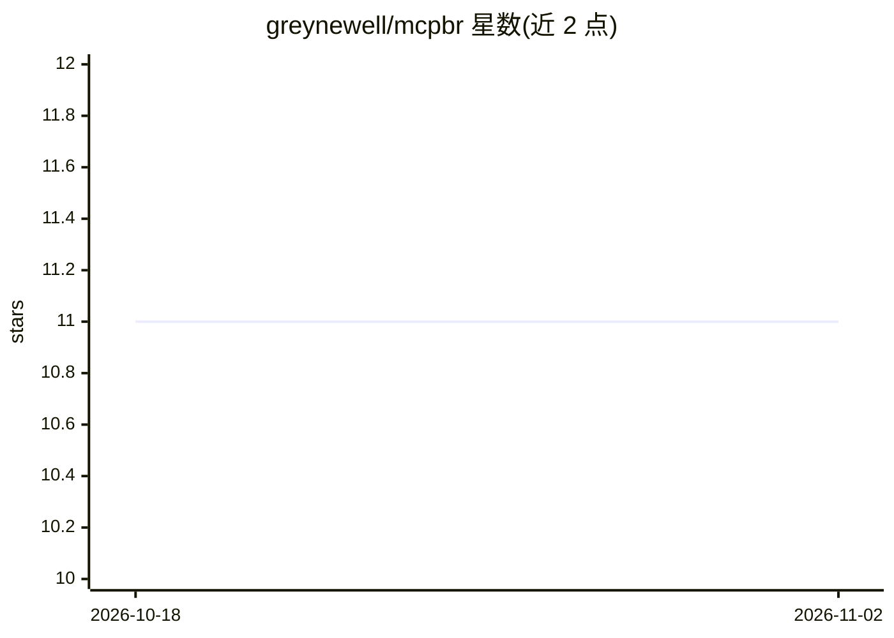

# greynewell/mcpbr

⭐ 11 · Python · MIT · 推送 2026-04-28 · [GitHub](https://github.com/greynewell/mcpbr) · 个人维护

**MCP 服务器基准评测工具：用真实 GitHub issue 量化工具收益**

面向 MCP 服务器开发者的评测运行器：对每个任务并行运行带 MCP 工具的 agent 与无工具的基线 agent，在相同模型与环境下对比解决率、工具调用数、token 用量与成本。内置 30+ 基准（默认 SWE-bench），通过 Docker 固定依赖保证可复现；支持回归检测（含 CI/CD 阈值退出码与 Slack/Discord/邮件告警）、两个 MCP 服务器并排对比、本地/Azure VM 两种基础设施模式。限制：需 Python 3.11+、运行中的 Docker、ANTHROPIC_API_KEY 与 Claude Code CLI。

## 筛选速览

| 维度 | 判定 | 备注 |
|---|---|---|
| AI 角色 | `ai-ecosystem` | LLM/agent 周边工具 |
| 许可风险 | `permissive` | MIT |
| 部署形态 | `self-host` | docker 或自建部署 |
| 模型依赖 | locked-api |  |
| 硬件要求 | — | 无带数字的原话,不猜 |
| 安装摩擦 | `low` | 无编译、无系统依赖或容器化 |
| 成熟度 | — | 结构信号不足 |

## 能力要点

- 带工具与基线 agent 的配对对照实验
- 支持 30+ 基准、10 大类任务，可通过 YAML 自定义
- 版本间回归检测，支持 CI/CD 阈值退出与多渠道告警
- 本地 Docker 与 Azure VM 自动供给两种运行模式

## 适用场景

- 验证我的 MCP server 是否真的提升 agent 任务表现
- 在 CI 中检测 MCP server 新版本的性能回归
- 并排对比两个 MCP server 实现的效果

## 场景标签

`模型评测` · 领域:评测与运维

## 证据(README 行号)

> L128: This harness runs two parallel evaluations for each task:
> L130: 1. **MCP Agent**: LLM with access to tools from your MCP server
> L131: 2. **Baseline Agent**: LLM without tools (single-shot generation)

## 星数曲线

2026-10-18 11 → 2026-11-02 11（+0）

---
*卡片 v1 · prompt 1.4 · 生成 2026-11-02 · 置信度 mid · 依据 README sha `275f77885d54` · [字段定义](../../DATASET.md)*
