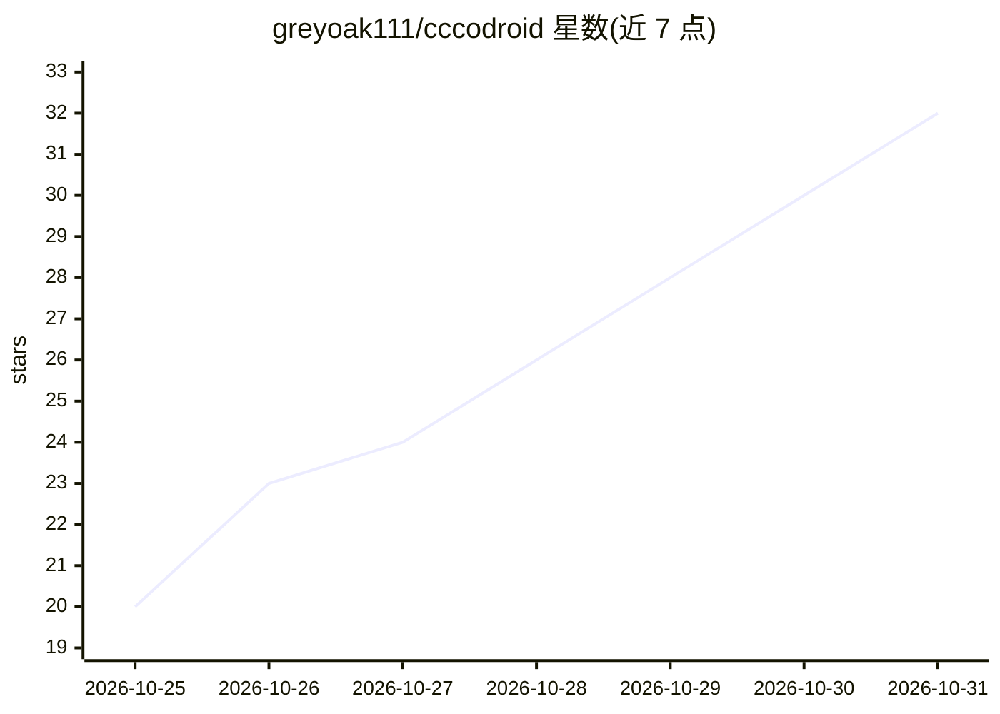

# greyoak111/cccodroid

⭐ 32 · JavaScript · Apache-2.0 · 推送 2026-10-30 · [GitHub](https://github.com/greyoak111/cccodroid) · [官网](https://cccodroid.net) · 个人维护 · 中文 README

**在 Android 手机上原生运行 Claude Code 的开发启动器**

无需 root、chroot/proot 或虚拟机的 Android 启动器，将官方未修改的 Claude Code（安装时从 Anthropic 官方渠道下载，经 sha256 清单校验）与图形化聊天界面、终端、文件浏览器/编辑器、git 面板、应用内浏览器一同运行在手机 Linux 内核上。提供模块化工具链（C/C++ 编译、Java/Android 打包、Python/Node 等）、项目与计划任务管理、多语言 UI（含简繁中文）、会话导出导入与 Lineage 谱系图。模型推理在云端，代码、文件与工具链留在本地。声明为第三方项目，与 Anthropic 无关。

## 筛选速览

| 维度 | 判定 | 备注 |
|---|---|---|
| AI 角色 | `ai-ecosystem` | LLM/agent 周边工具 |
| 许可风险 | `permissive` | Apache-2.0 |
| 部署形态 | `None` |  |
| 模型依赖 | locked-api |  |
| 硬件要求 | — | 无带数字的原话,不猜 |
| 安装摩擦 | `high` | 编译与系统依赖俱全 |
| 成熟度 | — | 结构信号不足 |

## 能力要点

- 运行官方未修改的 Claude Code，含 GUI 聊天、流式输出与工具调用
- 无需 root/chroot/proot，工具链原生运行于手机 Linux 内核
- 模块化工具链：C/C++ 编译、Java/Android 打包、Python/Node 等
- 项目/计划任务管理、会话导出导入、9 种界面语言

## 适用场景

- 在手机或平板上直接使用 Claude Code 做开发
- 本地编译 C/C++、运行 Python/Node、构建并推送 APK 与 git
- 按日程让 Claude 执行计划任务并限制成本与时长

## 场景标签

`编码 Agent` · 领域:编码与开发

## 证据(README 行号)

> L5: **A development launcher that runs Claude Code on Android phones.** No root, no custom ROM, no chroot / proot / VM.
> L27: cccodroid brings execution back to your own device: the cloud does model inference, while your code, files and tool

## 星数曲线

2026-10-25 20 → 2026-10-31 32（+12）

---
*卡片 v1 · prompt 1.4 · 生成 2026-10-27 · 置信度 high · 依据 README sha `04fb13bfe595` · [字段定义](../../DATASET.md)*
