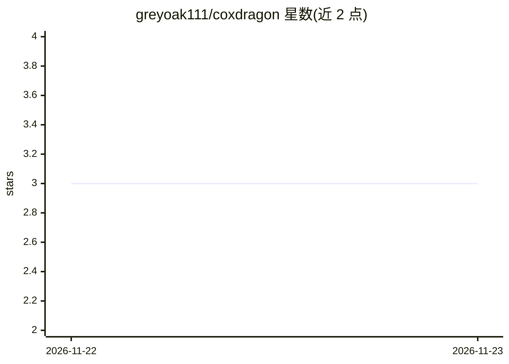

# greyoak111/coxdragon

⭐ 3 · JavaScript · AGPL-3.0 · 推送 2026-11-12 · [GitHub](https://github.com/greyoak111/coxdragon) · 个人维护 · 中文 README

**在 Android 应用内运行官方 Codex app-server 的图形工作台**

coxdragon 将 OpenAI 官方发布的 codex-app-server 下载到 Android 应用内运行，校验 SHA-256，通过仅监听回环、带令牌与 HMAC 认证的本地网关把 JSON-RPC 事件转为聊天式工作台：线程列表、流式消息、shell/patch/MCP 工具卡片与逐命令审批卡。登录采用 ChatGPT 设备码流程，不内置 API key。它是 cccodroid（Apache-2.0）的 fork，重新以 AGPL-3.0 许可发布。Codex 进程以应用 uid 运行，无需 root；可选工具来自独立组件市场。

## 筛选速览

| 维度 | 判定 | 备注 |
|---|---|---|
| AI 角色 | `ai-ecosystem` | LLM/agent 周边工具 |
| 许可风险 | `viral` | AGPL-3.0 |
| 部署形态 | `None` |  |
| 模型依赖 | — | README 未给出锁定关系 |
| 硬件要求 | — | 无带数字的原话,不猜 |
| 安装摩擦 | `medium` | 含编译或系统依赖之一 |
| 成熟度 | `idea` | |

## 能力要点

- 下载并校验 SHA-256 后运行 OpenAI 官方 codex-app-server，二进制未被修改
- 本地认证网关（回环绑定、per-install token、per-request HMAC）与显式审批卡机制
- ChatGPT 设备码登录，不内嵌 API key
- 从 cccodroid fork 而来，保留终端、文件浏览器、Shizuku 集成等外壳功能

## 适用场景

- 在 Android 设备上运行 Codex agent 执行编码任务
- 以审批卡方式逐条控制 agent 的命令与文件修改
- 在手机端维护多线程 Codex 会话与工具调用记录

## 场景标签

`编码 Agent` · 领域:编码与开发

## 证据(README 行号)

> L7: **Codex on Android, with a graphical workbench.** coxdragon runs OpenAI's official
> L8: Codex app-server inside an ordinary Android app, keeps it behind a local authenticated
> L24:  stdio JSON-RPC protocol (`initialize`, `thread/*`, `turn/*`, `account/*`).

## 星数曲线

2026-11-22 3 → 2026-11-23 3（+0）

---
*卡片 v1 · prompt 1.4 · 生成 2026-11-22 · 置信度 high · 依据 README sha `1ff65b666d22` · [字段定义](../../DATASET.md)*
