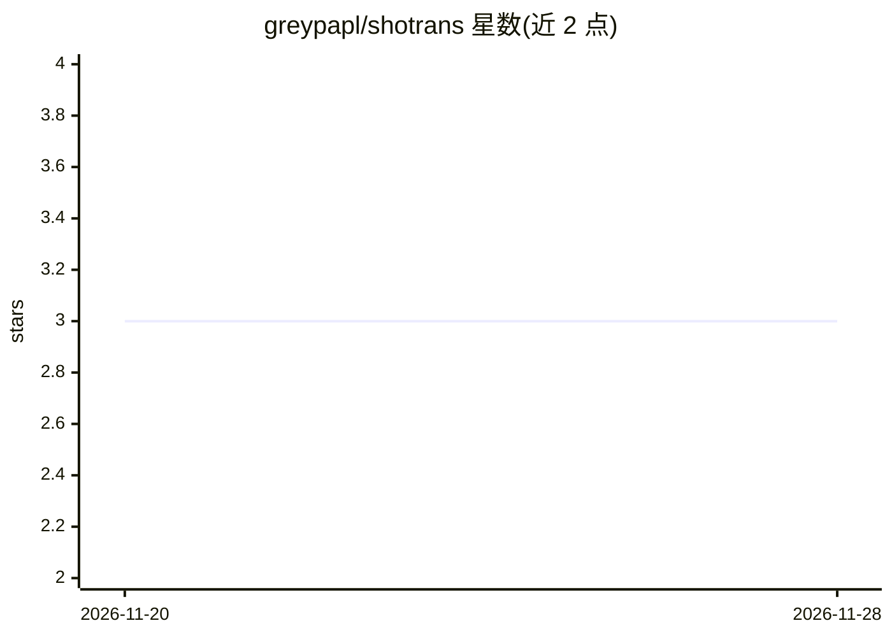

# greypapl/shotrans

⭐ 3 · Python · MIT · 推送 2026-11-26 · [GitHub](https://github.com/greypapl/shotrans) · 个人维护 · 中文 README

**Windows 截图翻译工具：译文按原排版盖在原文上**

面向 Windows 10/11 的截图翻译桌面工具：快捷键框选屏幕任意区域，OCR 在本机完成（依赖系统 OCR 语言包），译文按标题、段落、行内代码的原排版绘制回原位置，支持鼠标对照原文、双击复制、右键添加术语并即时重翻。翻译服务可选智谱 GLM-4.7-Flash、微软免费翻译、本机 Ollama、DeepSeek/硅基流动/阿里云百炼/OpenAI 预设或任意 OpenAI 兼容地址，支持主备多服务自动切换。提供 Releases zip 绿色版，也可用 conda 从源码运行。

## 筛选速览

| 维度 | 判定 | 备注 |
|---|---|---|
| AI 角色 | `ai-enhanced` | 去掉 AI 部分产品仍成立 |
| 许可风险 | `permissive` | MIT |
| 部署形态 | `desktop` | 安装包/桌面程序 |
| 模型依赖 | local-ok | 支持本地模型 |
| 硬件要求 | — | 无带数字的原话,不猜 |
| 安装摩擦 | `low` | 无编译、无系统依赖或容器化 |
| 成熟度 | — | 结构信号不足 |

## 能力要点

- 框选截图即翻译，译文按原排版覆盖原文位置
- OCR 本机完成，扫描 PDF/视频/游戏/界面文字均可翻译
- 术语表：指定译法后相关段落立即重翻
- 多翻译服务主备链自动切换，支持 Ollama 本机模型

## 适用场景

- 翻译扫描版 PDF 老书且保留原排版
- 翻游戏、软件界面里复制不了的文字
- 论文场景把中文草稿一键译成英文
- 断网或在意隐私时用本机 Ollama 翻译

## 场景标签

`OCR` · 领域:感知与多模态

## 证据(README 行号)

> L5: **框一下，译文就盖在原文上。** Windows 上的截图翻译工具：扫描版 PDF、视频画面、游戏、软件界面里的字，复制不了也能翻，排版不乱。
> L7: 免费 · 绿色版，解压即用 · 文字识别在本机完成 · 英译中 / 中译英
> L59: - **付费：** 内置 DeepSeek、硅基流动、阿里云百炼、OpenAI 几个预设，也可以填任意 OpenAI 兼容地址。

## 星数曲线

2026-11-20 3 → 2026-11-28 3（+0）

---
*卡片 v1 · prompt 1.4 · 生成 2026-11-22 · 置信度 high · 依据 README sha `681313416284` · [字段定义](../../DATASET.md)*
