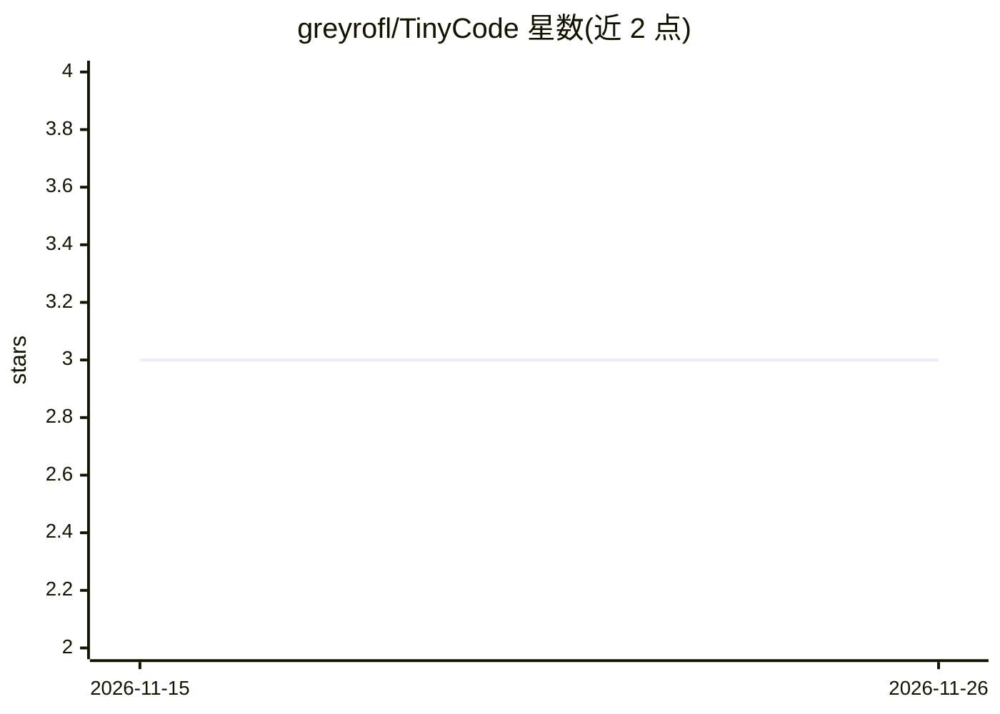

# greyrofl/TinyCode

⭐ 3 · TypeScript · MIT · 推送 2026-11-09 · [GitHub](https://github.com/greyrofl/TinyCode) · 个人维护 · 中文 README

**本地优先的终端编程 agent：管理 llama.cpp/Ollama 运行 GGUF 模型写代码**

TinyCode 是一个终端 UI 编程 agent，自管模型生命周期：通过托管的 llama.cpp 直接加载本地 GGUF 文件，可复用已装的 Ollama，也可连接显式配置的 OpenAI 兼容端点。内置 29 个工具（读写文件、Git、命令执行、网络），带守卫与审批机制；会话持久化、支持排队、重试、导出与上下文压缩；支持 Qwen 内嵌与 Gemma sidecar MTP 多 token 预测。需 Node.js 20.11+ 与已下载的模型，不自动下载权重，命令与 MCP 工具不在沙箱中运行。

## 筛选速览

| 维度 | 判定 | 备注 |
|---|---|---|
| AI 角色 | `ai-ecosystem` | LLM/agent 周边工具 |
| 许可风险 | `permissive` | MIT |
| 部署形态 | `library` | 以包/库形式分发 |
| 模型依赖 | local-ok | 支持本地模型 |
| 硬件要求 | — | 无带数字的原话,不猜 |
| 安装摩擦 | `low` | 无编译、无系统依赖或容器化 |
| 成熟度 | `idea` | |

## 能力要点

- 托管 llama.cpp 进程，提供 RAM/VRAM 遥测与受控重载
- 29 个内置工具加配置的 MCP 工具，带审批门控与调用守卫
- Qwen 内嵌 MTP 与 Gemma sidecar MTP 投机推理配置
- 持久会话、上下文压缩、one-shot 模式可组合进 shell 脚本

## 适用场景

- 在终端里用本地 GGUF 模型对项目做代码阅读与修改
- 已有 Ollama 安装时以编程 agent 方式驱动本地模型
- 无 GPU 隐私场景下让模型在受控工具循环中执行本地操作

## 场景标签

`编码 Agent` · 领域:编码与开发

## 证据(README 行号)

> L14: TinyCode is an experimental terminal coding agent for local models. It owns the
> L34: - approval-gated commands, verification and restricted MCP tools;
> L205: |Capability|llama.cpp|Ollama|OpenAI-compatible|

## 星数曲线

2026-11-15 3 → 2026-11-26 3（+0）

---
*卡片 v1 · prompt 1.4 · 生成 2026-11-22 · 置信度 high · 依据 README sha `165caa734655` · [字段定义](../../DATASET.md)*
