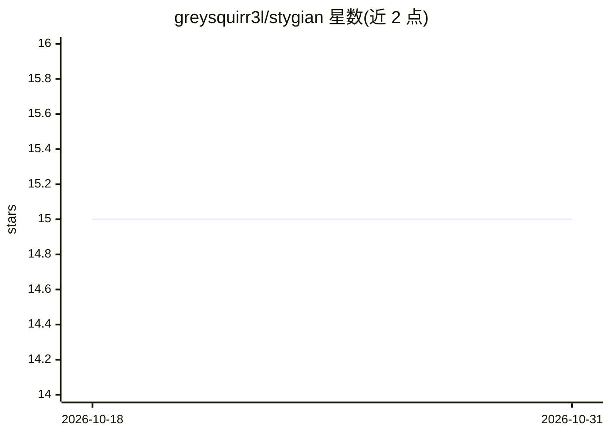

# greysquirr3l/stygian

⭐ 15 · Rust · AGPL-3.0 · 推送 2026-10-26 · [GitHub](https://github.com/greysquirr3l/stygian) · [官网](https://greysquirr3l.github.io/stygian) · 个人维护

**Rust 网页抓取工具集：图执行引擎与反检测浏览器自动化**

含六个 Rust crate 的 monorepo：stygian-graph 提供 DAG 图执行、AI 抽取与分布式执行；stygian-browser 提供反检测浏览器自动化（隐身特性、人类行为模拟）；另有代理池管理、HAR 取证与策略规划、基于 JSON-RPC 2.0 的 MCP 聚合器（可接入 Claude 或 VS Code）及带浏览器扩展的可视化数据抽取插件。架构为六边形设计，领域层零 I/O。采用 AGPL v3 与商业双许可，面向用 Rust 构建抓取系统的开发者。

## 筛选速览

| 维度 | 判定 | 备注 |
|---|---|---|
| AI 角色 | `ai-enhanced` | 去掉 AI 部分产品仍成立 |
| 许可风险 | `dual` | AGPL-3.0 |
| 部署形态 | `library` | 以包/库形式分发 |
| 模型依赖 | — | README 未给出锁定关系 |
| 硬件要求 | — | 无带数字的原话,不猜 |
| 安装摩擦 | `low` | 无编译、无系统依赖或容器化 |
| 成熟度 | — | 结构信号不足 |

## 能力要点

- 图执行抓取引擎（DAG、AI 抽取、分布式执行）
- 反检测浏览器自动化（隐身特性、人类行为模拟）
- MCP 聚合器经 JSON-RPC 2.0 接入 Claude/VS Code
- 代理池管理与 HAR 取证诊断

## 适用场景

- 用 Rust 构建大规模、分布式的网页抓取系统
- 规避反爬检测的浏览器自动化任务
- 让 LLM 通过 MCP 工具调用抓取能力

## 场景标签

`网页抓取` `浏览器自动化` · 领域:效率与自动化

## 证据(README 行号)

> L19: - **stygian-graph** — Graph-based scraping engine (DAGs, AI extraction, distributed execution)
> L20: - **stygian-browser** — Anti-detection browser automation (stealth features, human behavior)
> L23: - **stygian-mcp** — MCP aggregator (LLM tool integration via JSON-RPC 2.0)

## 星数曲线

2026-10-18 15 → 2026-10-31 15（+0）

---
*卡片 v1 · prompt 1.4 · 生成 2026-10-30 · 置信度 high · 依据 README sha `01af2a5f58cd` · [字段定义](../../DATASET.md)*
