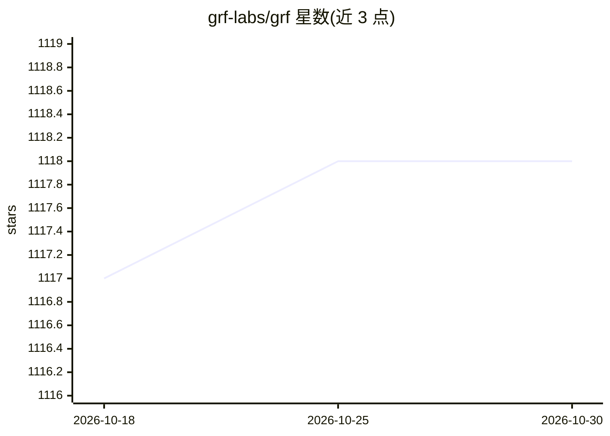

# grf-labs/grf

⭐ 1,118 · C++ · GPL-3.0 · 推送 2026-04-30 · [GitHub](https://github.com/grf-labs/grf) · [官网](https://grf-labs.github.io/grf/) · 组织维护

**R 包：森林方法做异质处理效应估计与统计推断**

基于森林的统计估计与推断 R 包（GRF），提供异质处理效应的非参数估计，支持右删失结局、多处理组、工具变量，以及最小二乘回归、分位数回归与生存回归，均支持协变量缺失。支持 honest 估计（一部分数据选分裂、另一部分填充叶子），并为最小二乘回归与处理效应估计提供置信区间。同时提供创建定制森林的框架，供开发新统计任务。经 CRAN 与 conda-forge 安装，源码安装需 C++17 编译器。由 NIH、NSF 等机构资助。

## 筛选速览

| 维度 | 判定 | 备注 |
|---|---|---|
| AI 角色 | `ai-native` | 本体是模型或模型工具 |
| 许可风险 | `viral` | GPL-3.0 |
| 部署形态 | `None` |  |
| 模型依赖 | — | README 未给出锁定关系 |
| 硬件要求 | — | 无带数字的原话,不猜 |
| 安装摩擦 | `low` | 无编译、无系统依赖或容器化 |
| 成熟度 | — | 结构信号不足 |

## 能力要点

- 异质处理效应估计，支持删失结局、多处理组与工具变量
- 最小二乘/分位数/生存回归，支持协变量缺失
- honest 估计与置信区间
- 可扩展框架：为新统计任务定制森林

## 适用场景

- 用因果森林估计异质处理效应并做统计推断
- 在含缺失协变量或删失结局的数据上做回归分析
- 开发定制化的森林统计方法

## 场景标签

 · 领域:统计学/因果推断

## 证据(README 行号)

> L7: A package for forest-based statistical estimation and inference. GRF provides non-parametric methods for heterogeneo
> L55: In addition to providing out-of-the-box forests for quantile regression and causal effect estimation, GRF provides 

## 星数曲线

2026-10-18 1,117 → 2026-10-30 1,118（+1）

---
*卡片 v1 · prompt 1.4 · 生成 2026-10-21 · 置信度 high · 依据 README sha `367ba36a370e` · [字段定义](../../DATASET.md)*
