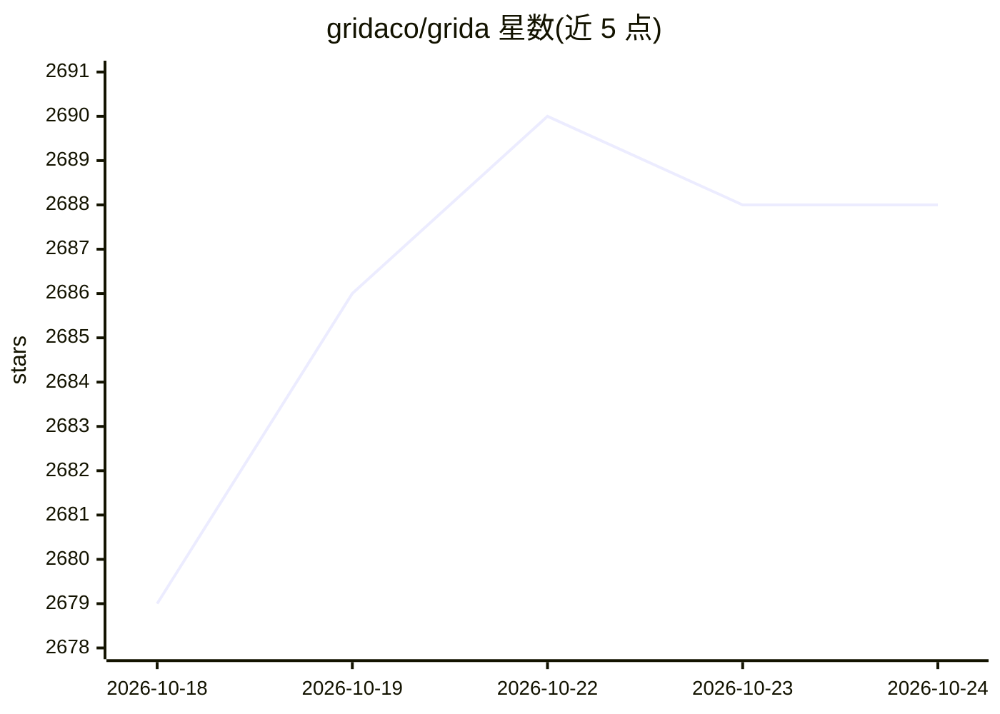

# gridaco/grida

⭐ 2,686 · TypeScript · Apache-2.0 · 推送 2026-10-19 · [GitHub](https://github.com/gridaco/grida) · [官网](https://grida.co) · 组织维护

**开源设计画布工具，AI 辅助创作图形与图像**

面向设计者与创意工作者的开源画布应用：在画布上组合图像、文字与矢量，可从 Figma 导入，使用 AI 探索方向和生成素材，再用内置设计工具继续编辑。支持自带 AI 供应商 API key 或通过 Ollama 使用本地文本模型，项目保存在本地文件夹。提供 macOS/Windows/Linux 桌面版本，另有 CLI 从终端生成媒体、Grida FX 资产工作流（预览中）与 AI Gateway（未发布）。基于自研 nothing 图形引擎，Apache 2.0 许可。

## 筛选速览

| 维度 | 判定 | 备注 |
|---|---|---|
| AI 角色 | `ai-enhanced` | 去掉 AI 部分产品仍成立 |
| 许可风险 | `permissive` | Apache-2.0 |
| 部署形态 | `None` |  |
| 模型依赖 | local-ok | 支持本地模型 |
| 硬件要求 | — | 无带数字的原话,不猜 |
| 安装摩擦 | `low` | 无编译、无系统依赖或容器化 |
| 成熟度 | `idea` | |

## 能力要点

- 画布上组合图像/文字/矢量并从 Figma 导入
- AI 探索方向与生成素材，支持自带 provider key 或 Ollama 本地模型
- Grida CLI 从终端/脚本/agent 生成媒体
- 跨平台桌面版（macOS/Windows/Linux）

## 适用场景

- 在开源画布上做图形设计与演示
- 用 AI 生成素材后继续手工精修
- 通过脚本或 agent 调用 CLI 批量生成媒体

## 场景标签

`图像生成` `图像视频处理` · 领域:内容生成

## 证据(README 行号)

> L7: Design graphics, create images, and make presentations with AI in Grida Desktop.
> L15: Bring images, type, and vectors together on an open canvas. Start with your own work, import from Figma, or find a 

## 星数曲线

2026-10-18 2,679 → 2026-10-24 2,688（+9）

---
*卡片 v1 · prompt 1.4 · 生成 2026-10-21 · 置信度 high · 依据 README sha `af8ade01fe2c` · [字段定义](../../DATASET.md)*
