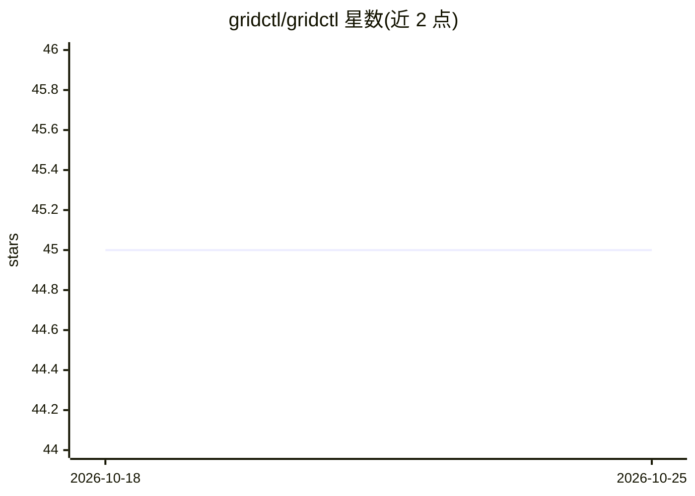

# gridctl/gridctl

⭐ 45 · Go · Apache-2.0 · 推送 2026-10-24 · [GitHub](https://github.com/gridctl/gridctl) · 组织维护

**MCP 网关与技能库：把 agent 环境声明进版本控制**

面向维护自有或团队共享 agent 配置的开发者：以 YAML stack 声明一组 MCP server，由网关统一启动与暴露，并将 Agent Skills、agent 定义与 agents.md 规则投影到所选客户端（lockfile 跟踪归属）。提供客户端自动发现与 link、从既有客户端配置反向 import、目录/注册表搜索添加 server、Python 容器镜像生成、执行沙箱模式、用量观测与 optimize 建议、输出格式转换（TOON/CSV）及工具白名单/分组/客户端级暴露控制。安装经 install.sh，运行需 Docker 或 Podman。不运行 agent 的规划或模型循环。

## 筛选速览

| 维度 | 判定 | 备注 |
|---|---|---|
| AI 角色 | `ai-ecosystem` | LLM/agent 周边工具 |
| 许可风险 | `permissive` | Apache-2.0 |
| 部署形态 | `self-host` | docker 或自建部署 |
| 模型依赖 | locked-api |  |
| 硬件要求 | — | 无带数字的原话,不猜 |
| 安装摩擦 | `low` | 无编译、无系统依赖或容器化 |
| 成熟度 | — | 结构信号不足 |

## 能力要点

- YAML 声明 MCP stack，单一网关统一暴露，支持漂移检测
- 自动发现并 link 16 种客户端，可反向 import 既有 MCP 配置
- generated Python 容器：固定 PyPI 版本、非 root 运行、免维护 Dockerfile
- 输出格式转换（TOON/CSV）与工具白名单/分组/客户端级暴露控制

## 适用场景

- 把团队的 MCP server、技能与规则纳入 git 版本控制并复现部署
- 多个 LLM 客户端共享同一组 MCP server，按客户端控制可见工具
- 扫描运行中的网关找出未使用的 server/工具并优化 token 消耗

## 场景标签

`模型网关` · 领域:Agent 开发

## 证据(README 行号)

> L18: Gridctl defines a stack of MCP servers in YAML, starts them, and exposes them through one gateway. Alongside the ga
> L30: Gridctl is for developers who maintain an agent setup of their own, or a shared one a team commits. MCP servers, sk
> L34: Gridctl does not run the agent's planning or model loop. Use an agent runtime of your choice over the gateway, and 

## 星数曲线

2026-10-18 45 → 2026-10-25 45（+0）

---
*卡片 v1 · prompt 1.4 · 生成 2026-10-25 · 置信度 mid · 依据 README sha `00405caa7b55` · [字段定义](../../DATASET.md)*
