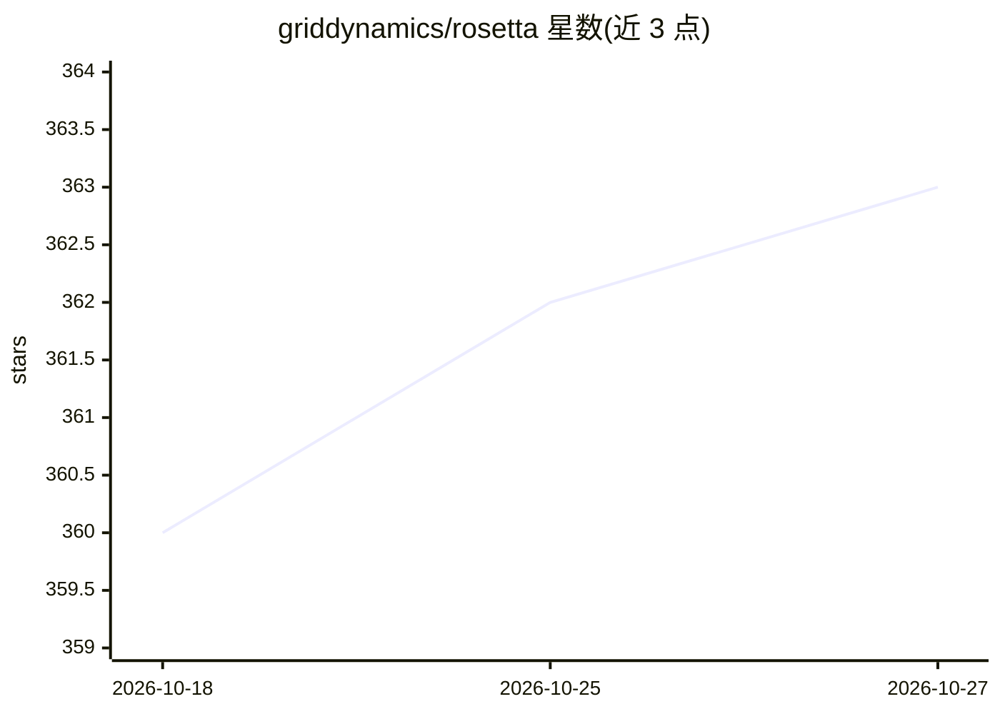

# griddynamics/rosetta

⭐ 363 · TypeScript · Apache-2.0 · 推送 2026-10-26 · [GitHub](https://github.com/griddynamics/rosetta) · [官网](https://griddynamics.github.io/rosetta/) · 组织维护

**面向 AI 编程 agent 的团队工程治理与共享指令层**

开源的 AI 编程 agent 指令层：将团队共享的工程规范、架构上下文、工作流与安全护栏以版本化方式注入 Claude Code、Cursor、Copilot、Codex 等 MCP 兼容 agent 的每次会话。提供约 30 类按需加载的技能（需求、设计、编码、测试、安全、编排等）、7 个顶层工作流（五阶段 Prepare→Research→Plan→Act→Validate）、Solr 领域包，以及子 agent 编排与人在环审批门。以 MCP server、插件与 CLI 三种形式分发，需 Python 3.12+，可在内网运行。

## 筛选速览

| 维度 | 判定 | 备注 |
|---|---|---|
| AI 角色 | `ai-ecosystem` | LLM/agent 周边工具 |
| 许可风险 | `permissive` | Apache-2.0 |
| 部署形态 | `None` |  |
| 模型依赖 | locked-api |  |
| 硬件要求 | — | 无带数字的原话,不猜 |
| 安装摩擦 | `low` | 无编译、无系统依赖或容器化 |
| 成熟度 | — | 结构信号不足 |

## 能力要点

- 共享工程指令版本化注入每个 agent 会话，支持 MCP 兼容 agent
- 约 30 类按需加载技能覆盖需求/设计/编码/测试/安全/编排
- 7 个顶层工作流，含五阶段流程与审批门
- 敏感数据脱敏、危险动作确认、风险评估等安全护栏

## 适用场景

- 团队统一各开发者对 AI 编程 agent 的指令与规范
- 让 agent 在动手前先读取项目架构与既往决策
- 通过审批门和独立审查子 agent 控制大中型编码任务
- 执行安全审查与测试生成等流程化工作流

## 场景标签

`提示工程` · 领域:Agent 开发

## 证据(README 行号)

> L3:  Engineering governance and context for AI coding agents — shared instructions, architecture, standards, workflows, 
> L21: That's why we built Rosetta — open-source engineering governance and context for AI coding agents. It's not another

## 星数曲线

2026-10-18 360 → 2026-10-27 363（+3）

---
*卡片 v1 · prompt 1.4 · 生成 2026-10-21 · 置信度 high · 依据 README sha `32dcfef86dce` · [字段定义](../../DATASET.md)*
