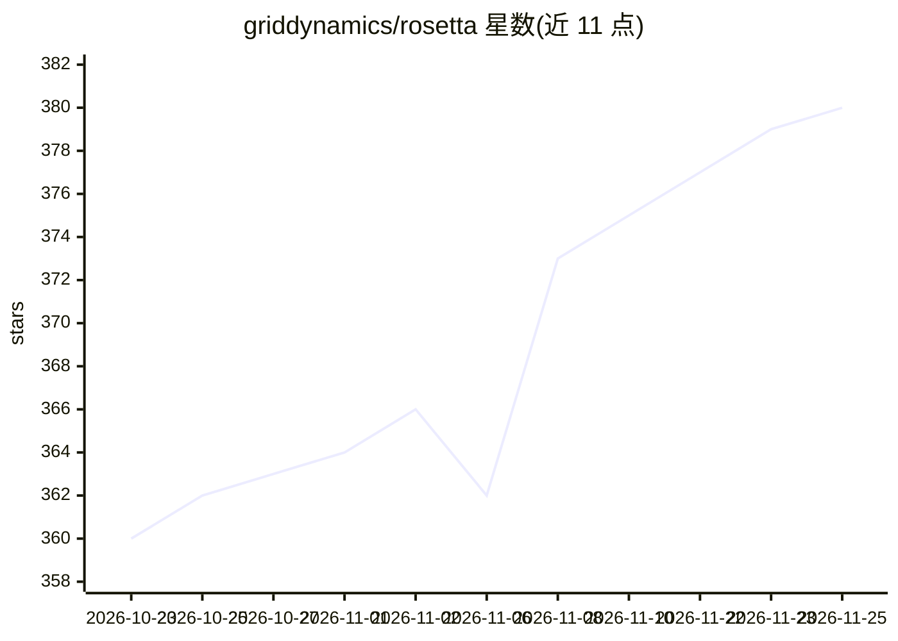

# griddynamics/rosetta

⭐ 380 · TypeScript · Apache-2.0 · 推送 2026-11-24 · [GitHub](https://github.com/griddynamics/rosetta) · [官网](https://griddynamics.github.io/rosetta/) · 组织维护

**给 AI 编码代理注入团队工程规范与上下文的指令层**

为 AI 编码代理提供共享工程治理层：将团队的架构说明、标准、工作流与护栏以 Git 版本化方式加载到每个代理会话中，支持 Claude Code、Cursor、Copilot、Codex 等 MCP 兼容代理。提供 MCP 服务与 CLI 两种形态，包含约 40 个按需加载的技能（需求编写、设计、编码、测试、调试、安全、QA、编排、敏感数据防护等）与五个阶段流程 Prepare→Research→Plan→Act→Validate，关键决策点设人工审批门。

## 筛选速览

| 维度 | 判定 | 备注 |
|---|---|---|
| AI 角色 | `ai-ecosystem` | LLM/agent 周边工具 |
| 许可风险 | `permissive` | Apache-2.0 |
| 部署形态 | `None` |  |
| 模型依赖 | — | README 未给出锁定关系 |
| 硬件要求 | — | 无带数字的原话,不猜 |
| 安装摩擦 | `low` | 无编译、无系统依赖或容器化 |
| 成熟度 | — | 结构信号不足 |

## 能力要点

- 技能以指令形式按需加载，涵盖需求、设计、编码、测试、安全、QA 等环节
- orchestration 技能可构建子代理团队并做新鲜上下文交叉审查
- coding-agents-farm 支持多代理在隔离 git worktree 上并行运行
- 内置敏感数据防护与危险操作审批门等安全护栏

## 适用场景

- 团队统一管理 AI 编码代理的指令与规范，避免各写各的提示词
- 大型代码库拆分为多个子代理并行处理
- 用工作流完成需求编写、安全审查或测试生成的端到端任务

## 场景标签

`提示工程` `编码 Agent` `Agent 框架` · 领域:Agent 开发

## 证据(README 行号)

> L3:  Engineering governance and context for AI coding agents — shared instructions, architecture, standards, workflows, 
> L21: That's why we built Rosetta — open-source engineering governance and context for AI coding agents. It's not another

## 星数曲线

2026-10-23 360 → 2026-11-25 380（+20）

---
*卡片 v1 · prompt 1.4 · 生成 2026-11-25 · 置信度 high · 依据 README sha `bbda88dfbc8b` · [字段定义](../../DATASET.md)*
