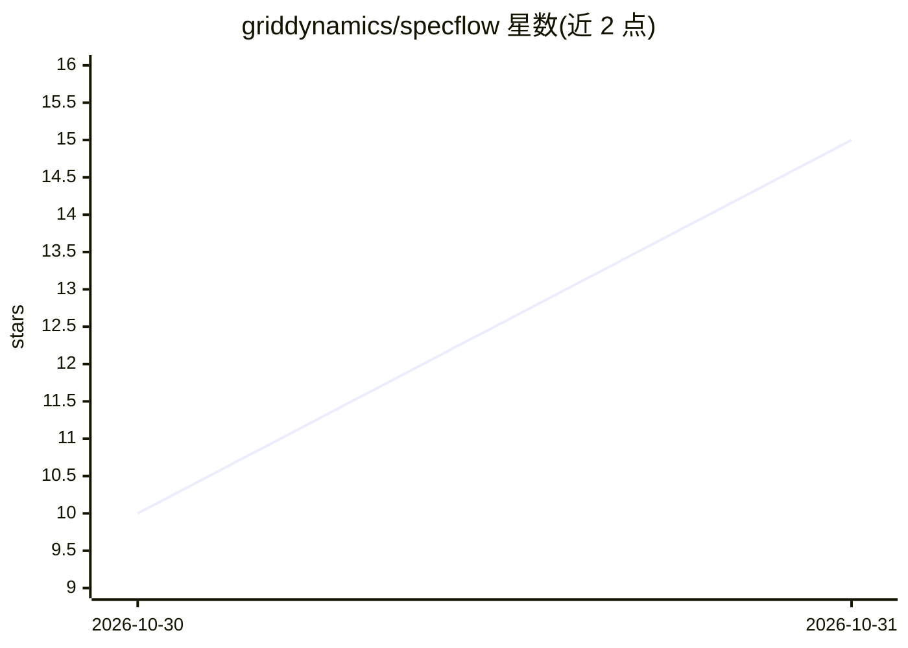

# griddynamics/specflow

⭐ 15 · Python · Apache-2.0 · 推送 2026-10-30 · [GitHub](https://github.com/griddynamics/specflow) · 组织维护

**面向 AI 编码代理的共享规范知识库与交付框架**

由 Grid Dynamics 维护的 agentic 交付工具：将分散的规范文档、代码库与演示文稿解析为团队共享的知识图谱，人两类使用者在同一上下文上工作。流程为解析来源、生成知识图谱、向负责人提出待决事项、生成实施计划；文档变更时仅增量更新受影响部分，词汇表来自本体文件可按领域调整。计划步骤交给 Rosetta harness 驱动编码代理（Claude Code/Cursor/Codex，经 MCP）读写图谱并在仓库工作。技术栈 Python 3.12 + Next.js 16，用 make 与 Docker Compose 启动全栈，需在 .env.local 配置 LLM 网关设置。

## 筛选速览

| 维度 | 判定 | 备注 |
|---|---|---|
| AI 角色 | `ai-ecosystem` | LLM/agent 周边工具 |
| 许可风险 | `permissive` | Apache-2.0 |
| 部署形态 | `None` |  |
| 模型依赖 | — | README 未给出锁定关系 |
| 硬件要求 | — | 无带数字的原话,不猜 |
| 安装摩擦 | `low` | 无编译、无系统依赖或容器化 |
| 成熟度 | — | 结构信号不足 |

## 能力要点

- 将代码库/文档/演示文稿解析为共享知识图谱并增量更新
- 词汇表来自本体文件，可按领域调整而无需改代码
- 通过 MCP 让 Claude Code/Cursor/Codex 等编码代理认领并更新功能
- 计划步骤经 Rosetta harness 驱动编码代理产出经评审的代码

## 适用场景

- 把数周编写的分散规范整合为团队与 AI 代理共用的知识图谱
- 让多个编码代理在同一图谱上下文中并行认领功能、避免冲突
- 在文档变更后自动维护需求知识库的时效性

## 场景标签

`知识图谱` `Agent 框架` · 领域:Agent 开发

## 证据(README 行号)

> L31:  alt="SpecFlow: one shared knowledge base for the team. Sources (codebase, documents, presentations) feed four step
> L40:  alt="What changes for your team: three developers with Claude Code, Cursor and Codex claim and update features in 
> L57: - Rosetta: the harness that turns plan steps into reviewed code

## 星数曲线

2026-10-30 10 → 2026-10-31 15（+5）

---
*卡片 v1 · prompt 1.4 · 生成 2026-10-31 · 置信度 high · 依据 README sha `21ebb5fd3a1c` · [字段定义](../../DATASET.md)*
