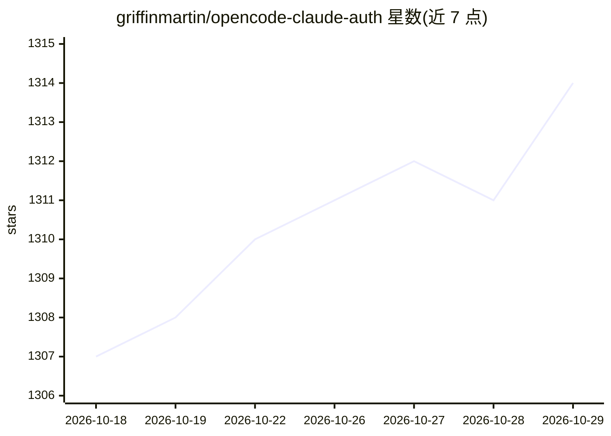

# griffinmartin/opencode-claude-auth

⭐ 1,314 · TypeScript · MIT · 推送 2026-10-16 · [GitHub](https://github.com/griffinmartin/opencode-claude-auth) · 个人维护

**OpenCode 2 插件：复用 Claude Code 订阅凭据登录 Anthropic**

面向 OpenCode 2 用户的认证提供插件：从 macOS Keychain 或 ~/.claude/.credentials.json 读取 Claude Code 的 OAuth 凭据，注册到 OpenCode 内置的 Anthropic provider 上，免去单独登录或 API key。刷新直接走 Anthropic OAuth 端点（不消耗 LLM token），支持多账号选择、1M 长上下文、环境变量覆盖与脱敏调试日志。3.0.0+ 仅支持 OpenCode 2，2.2.1 为支持 OpenCode 1 的最后版本；macOS 优先，Linux/Windows 走凭据文件回退。

## 筛选速览

| 维度 | 判定 | 备注 |
|---|---|---|
| AI 角色 | `ai-ecosystem` | LLM/agent 周边工具 |
| 许可风险 | `permissive` | MIT |
| 部署形态 | `library` | 以包/库形式分发 |
| 模型依赖 | locked-api |  |
| 硬件要求 | — | 无带数字的原话,不猜 |
| 安装摩擦 | `low` | 无编译、无系统依赖或容器化 |
| 成熟度 | — | 结构信号不足 |

## 能力要点

- 读取 Claude Code 订阅凭据（Keychain / credentials.json），无需 API key
- OAuth 刷新直连 Anthropic 端点，不消耗 LLM token
- macOS Keychain 多账号自动检测与订阅档位标注
- 支持 14 个 Claude 模型与 1M 长上下文

## 适用场景

- 在 OpenCode 中直接用我的 Claude Pro/Max 订阅，不另配 API key
- macOS 上多 Claude 账号间切换
- 排查 Anthropic 认证失败并输出脱敏日志

## 场景标签

 · 领域:AI 开发者工具/认证

## 证据(README 行号)

> L7: Self-contained Anthropic auth provider for OpenCode 2 using your Claude Code subscription credentials — no separate 
> L20: The plugin registers a Claude Code subscription auth method on OpenCode's built-in Anthropic provider. Run `/connec
> L22: OpenCode's native Anthropic provider handles prompt conversion and streaming. Session hooks add the Claude Code ide

## 星数曲线

2026-10-18 1,307 → 2026-10-29 1,314（+7）

---
*卡片 v1 · prompt 1.4 · 生成 2026-10-21 · 置信度 high · 依据 README sha `0c9b7d2d1d0d` · [字段定义](../../DATASET.md)*
