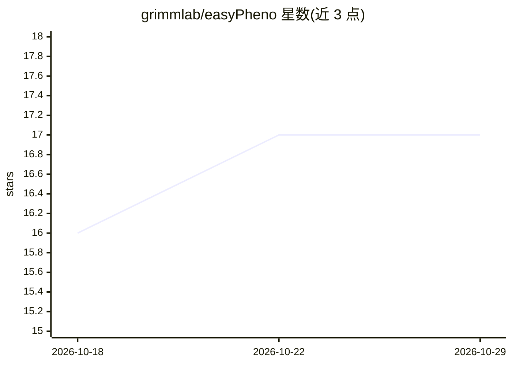

# grimmlab/easyPheno

⭐ 17 · Python · GPL-3.0 · 推送 2025-11-24 · [GitHub](https://github.com/grimmlab/easyPheno) · [官网](https://doi.org/10.1093/bioadv/vbad035) · 组织维护

**植物表型预测 Python 框架：训练、比较与分析多种模型**

用于植物表型预测（基因组选择）的模型无关 Python 框架，覆盖从 BLUP、贝叶斯字母族方法，到正则化线性回归、XGBoost 等集成学习、CNN 深度学习架构的多类预测模型；通过贝叶斯优化实现自动超参数调优，并支持用户进一步集成自定义预测模型。面向基因组选择与育种相关研究者，配有 readthedocs 文档、案例研究数据与 Bioinformatics Advances 2023 论文（doi: 10.1093/bioadv/vbad035）。安装方式需查阅其文档，README 未直接给出命令。

## 筛选速览

| 维度 | 判定 | 备注 |
|---|---|---|
| AI 角色 | `ai-native` | 本体是模型或模型工具 |
| 许可风险 | `viral` | GPL-3.0 |
| 部署形态 | `None` |  |
| 模型依赖 | — | README 未给出锁定关系 |
| 硬件要求 | — | 无带数字的原话,不猜 |
| 安装摩擦 | `low` | 无编译、无系统依赖或容器化 |
| 成熟度 | — | 结构信号不足 |

## 能力要点

- 内置 BLUP、贝叶斯字母族、XGBoost、CNN 等多类表型预测模型
- 基于贝叶斯优化的自动超参数优化
- 支持集成用户自定义预测模型
- 提供案例研究数据与配套论文

## 适用场景

- 对植物表型预测任务训练与比较多种模型
- 基因组选择场景下做预测模型评测与分析
- 利用贝叶斯优化自动调优模型超参数

## 场景标签

 · 领域:生物信息学/植物育种

## 证据(README 行号)

> L5: easyPheno is a Python framework that enables the rigorous training, comparison and analysis of phenotype predictions
> L7: Besides common genomic selection approaches, such as best linear unbiased prediction (BLUP) and models from the Baye

## 星数曲线

2026-10-18 16 → 2026-10-29 17（+1）

---
*卡片 v1 · prompt 1.4 · 生成 2026-10-29 · 置信度 high · 依据 README sha `f6ee1d44779d` · [字段定义](../../DATASET.md)*
