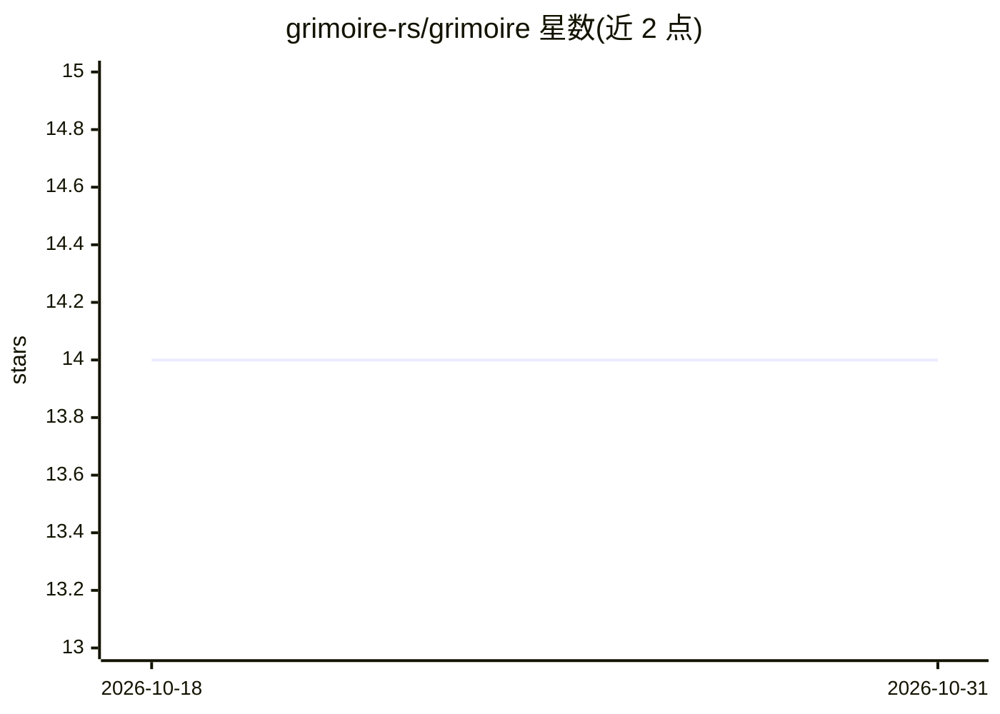

# grimoire-rs/grimoire

⭐ 14 · Rust · Apache-2.0 · 推送 2026-10-28 · [GitHub](https://github.com/grimoire-rs/grimoire) · [官网](https://grimoire.rs) · 组织维护

**AI agent 配置包管理器：将技能/规则/MCP 装入各编码 agent**

grim 是面向 AI 编码 agent 配置的包管理 CLI：一次性声明 skill、rule、agent、MCP server 与 bundle，即写入 Claude Code、Copilot、Cursor、Codex、Gemini、Zed、Amp、Kiro、Junie、opencode 等客户端各自读取的格式，并以 digest 固定到 lockfile。存储使用任意 OCI registry（GHCR、Docker Hub 或自建），无中心服务。客户端不支持某 artifact 时明确跳过并声明；可自建 package index（经 GitHub/GitLab Pages 服务，无数据库无账号）。当前处于向 1.0 稳定阶段。

## 筛选速览

| 维度 | 判定 | 备注 |
|---|---|---|
| AI 角色 | `ai-ecosystem` | LLM/agent 周边工具 |
| 许可风险 | `permissive` | Apache-2.0 |
| 部署形态 | `library` | 以包/库形式分发 |
| 模型依赖 | — | README 未给出锁定关系 |
| 硬件要求 | — | 无带数字的原话,不猜 |
| 安装摩擦 | `low` | 无编译、无系统依赖或容器化 |
| 成熟度 | — | 结构信号不足 |

## 能力要点

- 一次声明、写入 10 种编码 agent 客户端各自的配置格式
- lockfile 以 digest 固定版本，grim install 克隆后重建
- 存储为任意 OCI registry，无中心服务与账号
- 可自建 package index（npx 脚手架 + Pages 托管），含贡献门禁

## 适用场景

- 统一管理多个编码 agent 的技能与 MCP 配置
- 团队以 lockfile 保证各成员 agent 配置一致
- 私有仓库内部分发 agent 配置包

## 场景标签

`提示工程` · 领域:Agent 开发

## 证据(README 行号)

> L3: **A package manager for AI-agent config — skills, rules, agents, and MCP
> L11: Declare a skill once and `grim` writes it into Claude Code, Copilot, Cursor,

## 星数曲线

2026-10-18 14 → 2026-10-31 14（+0）

---
*卡片 v1 · prompt 1.4 · 生成 2026-10-31 · 置信度 mid · 依据 README sha `8f7506cb8851` · [字段定义](../../DATASET.md)*
