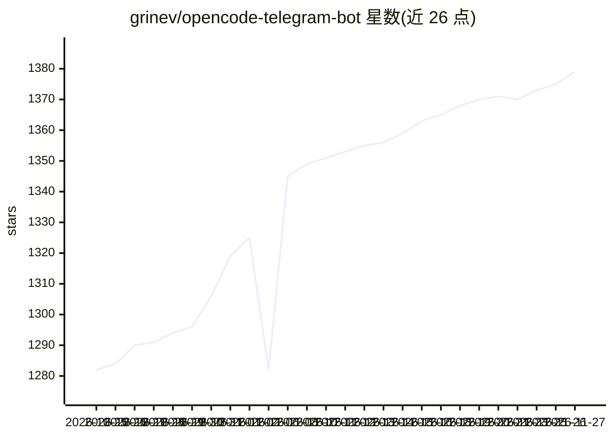

# grinev/opencode-telegram-bot

⭐ 1,379 · TypeScript · MIT · 推送 2026-11-25 · [GitHub](https://github.com/grinev/opencode-telegram-bot) · 个人维护 · 中文 README

**通过 Telegram 在手机上远程运行与监控本地 OpenCode 编码任务的客户端**

一个运行在本机的 Telegram 机器人，作为 OpenCode CLI 的移动端客户端：从手机发送提示、跟踪会话进度、切换模型、管理会话与项目、切换 git worktree，并支持文件/图片/PDF 附件、语音转写提示（Whisper 兼容 API）、定时任务、消息队列与上下文/成本查看。安全机制为用户 ID 白名单，不开放端口。需 Node.js 22.14+ 与本机运行的 OpenCode 服务器，支持 V1 与 V2，提供 npm 全局安装与 Docker 部署，支持 macOS/Windows/Linux 与 13 种界面语言。

## 筛选速览

| 维度 | 判定 | 备注 |
|---|---|---|
| AI 角色 | `ai-ecosystem` | LLM/agent 周边工具 |
| 许可风险 | `permissive` | MIT |
| 部署形态 | `self-host` | docker 或自建部署 |
| 模型依赖 | — | README 未给出锁定关系 |
| 硬件要求 | — | 无带数字的原话,不猜 |
| 安装摩擦 | `low` | 无编译、无系统依赖或容器化 |
| 成熟度 | — | 结构信号不足 |

## 能力要点

- 远程发送编码任务并以文件形式接收完整结果
- 实时状态置顶消息：项目/worktree、模型、上下文用量与变更文件
- 内置命令覆盖会话、消息回滚/分叉、MCP 服务器、定时任务管理
- 语音消息经 Whisper 兼容 API 转写为提示，支持 Docker 部署

## 适用场景

- 离开电脑时用手机继续驱动和监控 AI 编码任务
- 在本地机器上运行 OpenCode，同时不暴露任何端口或 API
- 通过 Telegram 审批 agent 的提问与权限请求

## 场景标签

`编码 Agent` · 领域:编码与开发

## 证据(README 行号)

> L11: OpenCode Telegram Bot is a secure Telegram client for OpenCode CLI that runs on your local machine.
> L13: Run AI coding tasks, monitor progress, switch models, and manage sessions from your phone.
> L30: - **OpenCode V2 support** — works with the new OpenCode V2 as well as the classic V1; for setup details, see Old an

## 星数曲线

2026-10-25 1,282 → 2026-11-27 1,379（+97）

---
*卡片 v1 · prompt 1.4 · 生成 2026-11-26 · 置信度 high · 依据 README sha `a08f7cd736de` · [字段定义](../../DATASET.md)*
