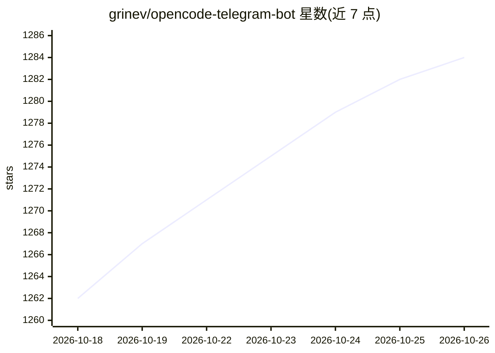

# grinev/opencode-telegram-bot

⭐ 1,284 · TypeScript · MIT · 推送 2026-10-21 · [GitHub](https://github.com/grinev/opencode-telegram-bot) · 个人维护

**通过 Telegram 远程运行和监控本地 OpenCode 编码任务的客户端**

运行在用户本机的 Telegram Bot，作为 OpenCode CLI 的移动客户端：从手机发送编码任务提示、接收代码结果文件、管理会话、切换模型与 Agent 模式（Plan/Build）、查看上下文用量与文件变更的实时置顶状态。支持语音转文字提示、文件附件、定时任务、消息队列、会话回滚与分叉、git worktree 切换、交互式文件浏览。安全机制为严格用户 ID 白名单，不开放端口，仅与本地 OpenCode 服务器和 Telegram Bot API 通信。需 Node.js 22.14+ 与本地 OpenCode，通过 npx 或 npm 全局安装运行，也支持 Docker（OpenCode 留在宿主机）。

## 筛选速览

| 维度 | 判定 | 备注 |
|---|---|---|
| AI 角色 | `ai-ecosystem` | LLM/agent 周边工具 |
| 许可风险 | `permissive` | MIT |
| 部署形态 | `self-host` | docker 或自建部署 |
| 模型依赖 | — | README 未给出锁定关系 |
| 硬件要求 | — | 无带数字的原话,不猜 |
| 安装摩擦 | `low` | 无编译、无系统依赖或容器化 |
| 成熟度 | — | 结构信号不足 |

## 能力要点

- 远程发送提示并接收带代码文件的结果，会话管理与实时状态跟踪
- 模型切换、Agent 模式切换、自定义命令与技能目录内联运行
- 语音消息经 Whisper 兼容 API 转写后作为提示发送
- 严格用户 ID 白名单，无开放端口与暴露 API

## 适用场景

- 离开电脑时用手机继续监控和操作 OpenCode 编码任务
- 定时或周期性让编码代理执行例行代码维护
- 在手机上回答代理提问并批准权限请求

## 场景标签

`编码 Agent` · 领域:编码与开发

## 证据(README 行号)

> L10: OpenCode Telegram Bot is a secure Telegram client for OpenCode CLI that runs on your local machine.
> L27: - **Remote coding** — send prompts to OpenCode from anywhere, receive complete results with code sent as files

## 星数曲线

2026-10-18 1,262 → 2026-10-26 1,284（+22）

---
*卡片 v1 · prompt 1.4 · 生成 2026-10-21 · 置信度 high · 依据 README sha `7d61e1f0de02` · [字段定义](../../DATASET.md)*
