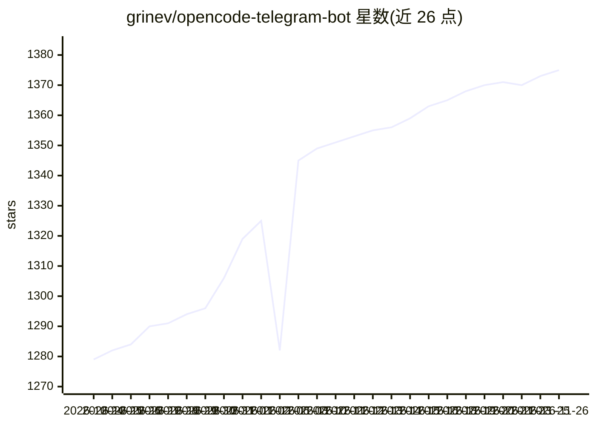

# grinev/opencode-telegram-bot

⭐ 1,375 · TypeScript · MIT · 推送 2026-11-25 · [GitHub](https://github.com/grinev/opencode-telegram-bot) · 个人维护

**OpenCode 的 Telegram 移动客户端：手机远程运行监控 AI 编码任务**

运行在本地机器上的 Telegram 机器人，作为 OpenCode CLI 的客户端：通过 Telegram 发送编码任务、实时查看会话状态、切换模型、管理会话与项目、切换 git worktree、回复代理提问并批准权限。支持 OpenCode V1/V2，语音消息经 Whisper 兼容 API 转写为提示词，支持定时任务、消息队列与文件附件/回传。仅连接本地 OpenCode 服务器与 Telegram Bot API，无开放端口，通过用户 ID 白名单限制访问。以 npm 包分发，支持 Docker 部署，UI 支持 13 种语言。

## 筛选速览

| 维度 | 判定 | 备注 |
|---|---|---|
| AI 角色 | `ai-ecosystem` | LLM/agent 周边工具 |
| 许可风险 | `permissive` | MIT |
| 部署形态 | `self-host` | docker 或自建部署 |
| 模型依赖 | — | README 未给出锁定关系 |
| 硬件要求 | — | 无带数字的原话,不猜 |
| 安装摩擦 | `low` | 无编译、无系统依赖或容器化 |
| 成熟度 | — | 结构信号不足 |

## 能力要点

- 支持 OpenCode V1/V2，从手机发送任务并实时监控会话、子代理进度与上下文用量
- 语音消息经 Whisper 兼容 API 转写为提示词
- 会话管理：新建/继续/搜索、消息回退（Revert）与分叉（Fork）、定时任务
- 严格用户 ID 白名单与无开放端口的安全设计，支持 Docker 与 systemd 部署

## 适用场景

- 离开电脑时用手机远程下发并监控 AI 编码任务
- 通过 Telegram 管理多个 OpenCode 项目、会话与 worktree
- 用定时任务在指定时间或周期性运行编码提示词
- 以语音消息形式向编码代理下达指令

## 场景标签

`编码 Agent` · 领域:编码与开发

## 证据(README 行号)

> L11: OpenCode Telegram Bot is a secure Telegram client for OpenCode CLI that runs on your local machine.
> L13: Run AI coding tasks, monitor progress, switch models, and manage sessions from your phone.
> L30: - **OpenCode V2 support** — works with the new OpenCode V2 as well as the classic V1; for setup details, see Old an

## 星数曲线

2026-10-24 1,279 → 2026-11-26 1,375（+96）

---
*卡片 v1 · prompt 1.4 · 生成 2026-11-24 · 置信度 high · 依据 README sha `7184f4908993` · [字段定义](../../DATASET.md)*
