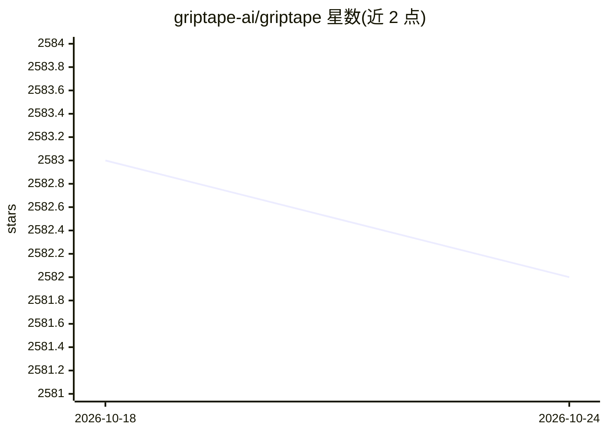

# griptape-ai/griptape

⭐ 2,582 · Python · Apache-2.0 · 推送 2026-10-23 · [GitHub](https://github.com/griptape-ai/griptape) · [官网](https://www.griptape.ai) · 组织维护

**构建 AI agent 与工作流的模块化 Python 框架**

面向生成式 AI 应用开发的 Python 框架：以 Structures（Agents/Pipelines/Workflows）组织 Tasks，通过可替换的 Drivers 接入 LLM、向量存储、嵌入、图像生成、语音、Web 搜索与可观测性等外部服务；提供对话/任务/元记忆三种 Memory、内置与自定义 Tools，以及 RAG、抽取、摘要、评测四类 Engines。附带 Rulesets、Loaders、Chunkers、Tokenizers 等组件。另有可视化桌面产品 Griptape Nodes 供无代码使用，Apache 2.0 许可。

## 筛选速览

| 维度 | 判定 | 备注 |
|---|---|---|
| AI 角色 | `ai-ecosystem` | LLM/agent 周边工具 |
| 许可风险 | `permissive` | Apache-2.0 |
| 部署形态 | `library` | 以包/库形式分发 |
| 模型依赖 | — | README 未给出锁定关系 |
| 硬件要求 | — | 无带数字的原话,不猜 |
| 安装摩擦 | `low` | 无编译、无系统依赖或容器化 |
| 成熟度 | — | 结构信号不足 |

## 能力要点

- Structures（Agents/Pipelines/Workflows）+ Tasks 的任务组织模型
- 可替换 Drivers 覆盖 LLM、检索存储、多模态、Web 与可观测性
- RAG/抽取/摘要/评测四类 Engines 与三类 Memory 组件
- 内置 Tools 并支持自定义工具创建

## 适用场景

- 构建多步骤的 AI agent 与并行工作流应用
- 通过模块化 RAG 引擎搭建检索增强生成管线
- 从非结构化文本抽取 JSON/CSV 数据或生成摘要

## 场景标签

`Agent 框架` `RAG` · 领域:Agent 开发

## 证据(README 行号)

> L11: Griptape is a Python framework designed to simplify the development of generative AI (genAI) applications.
> L36: Drivers facilitate interactions with external resources and services in Griptape.

## 星数曲线

2026-10-18 2,583 → 2026-10-24 2,582（-1）

---
*卡片 v1 · prompt 1.4 · 生成 2026-10-21 · 置信度 high · 依据 README sha `769eafb6eaed` · [字段定义](../../DATASET.md)*
