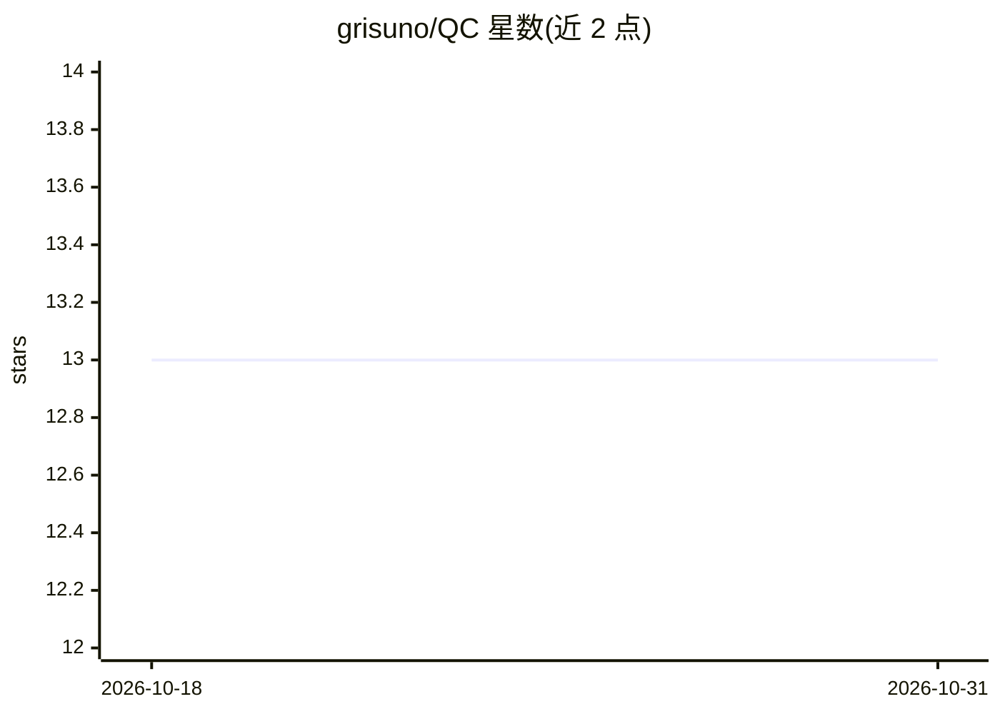

# grisuno/QC

⭐ 13 · HTML · AGPL-3.0 · 推送 2026-10-29 · [GitHub](https://github.com/grisuno/QC) · [官网](https://doi.org/10.5281/zenodo.18407920) · 个人维护

**经典硬件上的量子计算模拟器，含教育 TUI 与 GPU 可视化**

在经典硬件上模拟量子系统的 Python 框架：提供全态矢量精确模式（约 14 量子比特）与 MPS 张量网络可扩展模式（33+ 量子比特），共享同一门库与算法集。内置 Grover、QFT、VQE（H2 100% 相关能恢复）、极化率、QED 效应等计算模块，部分物理后端由神经网络实现（torch，含可微调的 Hamiltonian 网络）。附带英/西双语教育 TUI、交互式菜单（11 个板块）与 OpenGL 沉浸式查看器；已知限制包括学习型 Hamiltonian 网络非厄米（约 11% 缺陷）。面向科研与教学用户，以源码方式运行。

## 筛选速览

| 维度 | 判定 | 备注 |
|---|---|---|
| AI 角色 | `ai-enhanced` | 去掉 AI 部分产品仍成立 |
| 许可风险 | `viral` | AGPL-3.0 |
| 部署形态 | `library` | 以包/库形式分发 |
| 模型依赖 | — | README 未给出锁定关系 |
| 硬件要求 | — | 无带数字的原话,不猜 |
| 安装摩擦 | `low` | 无编译、无系统依赖或容器化 |
| 成熟度 | — | 结构信号不足 |

## 能力要点

- 双模式：全态矢量精确（~14 qubits）与 MPS 张量网络（33+ qubits）运行时可切换
- 量子化学模块：H2 VQE 达 100% 相关能恢复，含 H2/LiH/H2O 分子数据
- 英/西双语教育 TUI，6 课含实时 VQE 梯度下降动画
- OpenGL GPU 沉浸式查看器：7 类场景（原子/自旋/物质/里德堡等），RTX 2060 上 70-170 fps

## 适用场景

- 在普通电脑上模拟量子电路与纠缠特性，无需量子硬件
- 用 VQE 做小分子量子化学计算与能量面探索
- 通过交互课程学习量子计算、测量与纠缠概念
- 可视化氢原子轨道、里德堡波包等量子物理现象

## 场景标签

`科研工具` `教程课程` · 领域:学习与行业

## 证据(README 行号)

> L7: > A functional quasi-quantum computing simulator on classical hardware using physics models as a backend, now extend
> L11: Q²C simulates quantum systems on classical hardware through two complementary modes selectable at runtime:
> L167: A proof of concept that retrains the Hamiltonian network with the same architecture and checkpoint layout as the p

## 星数曲线

2026-10-18 13 → 2026-10-31 13（+0）

---
*卡片 v1 · prompt 1.4 · 生成 2026-10-31 · 置信度 mid · 依据 README sha `f3af9310b844` · [字段定义](../../DATASET.md)*
