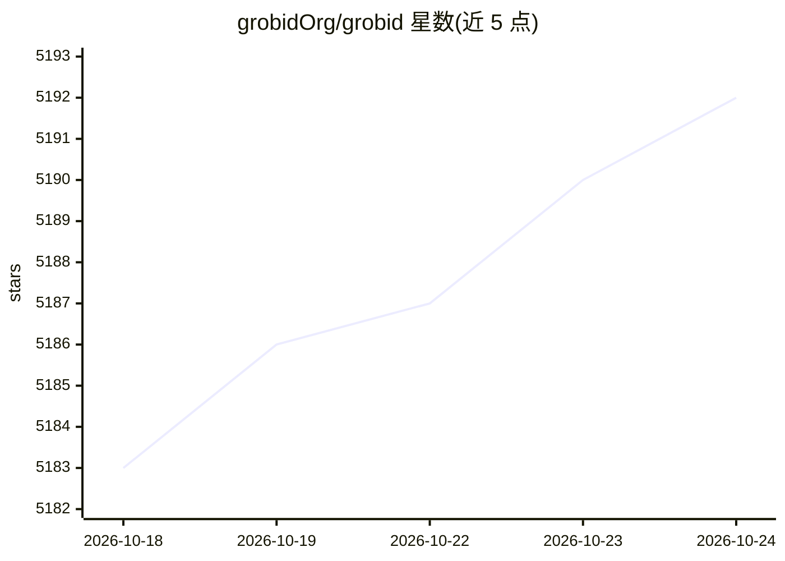

# grobidOrg/grobid

⭐ 5,193 · Java · Apache-2.0 · 推送 2026-10-24 · [GitHub](https://github.com/grobidOrg/grobid) · [官网](https://grobid.readthedocs.io) · 组织维护

**从学术 PDF 提取结构化信息的机器学习库**

将 PDF 等原始文献解析为 XML/TEI 结构化文档的机器学习库，面向学术论文处理：标题/作者/摘要等头部信息、参考文献解析（.87-.90 F1）、引用上下文关联、全文结构化、人名/机构/日期解析、资助与版权信息识别。模型为级联序列标注，基于 Layout Tokens 结合视觉布局信息，默认 CRF、可选 DeLFT 深度学习模型（RNN/transformers）。提供 Web 服务 API、Docker 镜像、批处理、Java API 与训练评估框架；需 OpenJDK 21，Linux/macOS 原生构建，Windows 支持中断。

## 筛选速览

| 维度 | 判定 | 备注 |
|---|---|---|
| AI 角色 | `ai-native` | 本体是模型或模型工具 |
| 许可风险 | `permissive` | Apache-2.0 |
| 部署形态 | `None` |  |
| 模型依赖 | — | README 未给出锁定关系 |
| 硬件要求 | — | 无带数字的原话,不猜 |
| 安装摩擦 | `medium` | 含编译或系统依赖之一 |
| 成熟度 | — | 结构信号不足 |

## 能力要点

- PDF→XML/TEI 结构化，68 个标签覆盖文献元数据与全文结构
- 参考文献解析 F1 约 .87-.90，DOI/PMID 解析 F1 高于 0.95
- 级联序列标注模型基于 Layout Tokens，结合文本与视觉布局信息
- 提供 Web 服务 API、Docker 镜像、多语言客户端与训练评估框架

## 适用场景

- 批量解析学术论文 PDF 提取元数据与全文结构
- 文献引用关系抽取与参考文献解析
- 构建学术全文语料库（配合 article-dataset-builder）

## 场景标签

`文档解析` · 领域:知识与检索

## 证据(README 行号)

> L19: GROBID is a machine learning library for extracting, parsing and re-structuring raw documents such as PDF into stru
> L56: GROBID uses Deep Learning models relying on the DeLFT library, a task-agnostic Deep Learning framework for sequence

## 星数曲线

2026-10-18 5,183 → 2026-10-24 5,192（+9）

---
*卡片 v1 · prompt 1.4 · 生成 2026-10-20 · 置信度 high · 依据 README sha `7ef7e4073ed2` · [字段定义](../../DATASET.md)*
