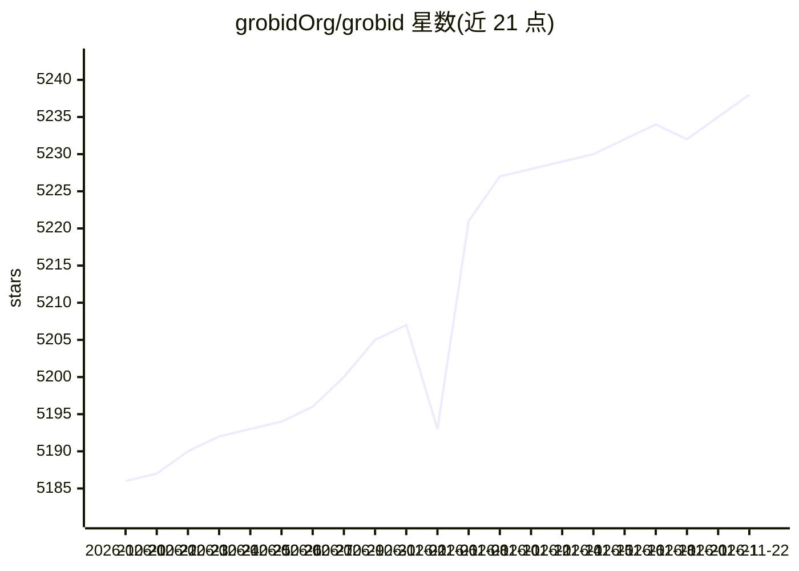

# grobidOrg/grobid

⭐ 5,238 · Java · Apache-2.0 · 推送 2026-11-21 · [GitHub](https://github.com/grobidOrg/grobid) · [官网](https://grobid.readthedocs.io) · 组织维护

**从学术 PDF 抽取结构化文献信息的机器学习库**

GROBID（Generation Of Bibliographic Data）以机器学习将 PDF 等原始文档解析为结构化 XML/TEI，聚焦技术与科学出版物。功能覆盖标题区抽取、参考文献抽取与解析、引文上下文消解、全文分段结构化、PDF 坐标定位、姓名/机构/日期解析及经 CrossRef 的文献条目归一。模型为 CRF（默认）与基于 DeLFT 的深度学习（RNN/transformers）可混合配置，通过 JEP 接入，可选 CUDA GPU 加速。提供 Web 服务 API、Java API、Docker 镜像、Python/Java/Node.js 多线程客户端与训练评估框架，默认仅启用 CRF 以适配普通硬件。

## 筛选速览

| 维度 | 判定 | 备注 |
|---|---|---|
| AI 角色 | `ai-native` | 本体是模型或模型工具 |
| 许可风险 | `permissive` | Apache-2.0 |
| 部署形态 | `None` |  |
| 模型依赖 | — | README 未给出锁定关系 |
| 硬件要求 | — | 无带数字的原话,不猜 |
| 安装摩擦 | `medium` | 含编译或系统依赖之一 |
| 成熟度 | — | 结构信号不足 |

## 能力要点

- PDF 到 XML/TEI 的头部、参考文献与全文结构化抽取，管理 68 个输出标签
- CRF 默认配置与可切换的 Deep Learning 模型（RNN/transformers）混合运行
- 提供 Web 服务 API、Java API、Docker 镜像与 Python/Java/Node.js/Go 客户端
- 内置训练、评估与半自动训练数据生成框架

## 适用场景

- 批量解析学术论文 PDF 抽取标题、作者、DOI 等元数据
- 为文献库构建将海量 PDF 转为结构化全文
- 抽取专利文献中的专利与非专利参考文献
- 在科研 PDF 上做软件提及、命名实体等结构感知文本挖掘

## 场景标签

`文档解析` `科研工具` · 领域:知识与检索

## 证据(README 行号)

> L19: GROBID is a machine learning library for extracting, parsing and re-structuring raw documents such as PDF into stru
> L56: GROBID uses Deep Learning models relying on the DeLFT library, a task-agnostic Deep Learning framework for sequence
> L41: GROBID can be considered as production ready. Deployments in production includes ResearchGate, Semantic Scholar, HA

## 星数曲线

2026-10-20 5,186 → 2026-11-22 5,238（+52）

---
*卡片 v1 · prompt 1.4 · 生成 2026-11-22 · 置信度 high · 依据 README sha `87c0283d2f30` · [字段定义](../../DATASET.md)*
