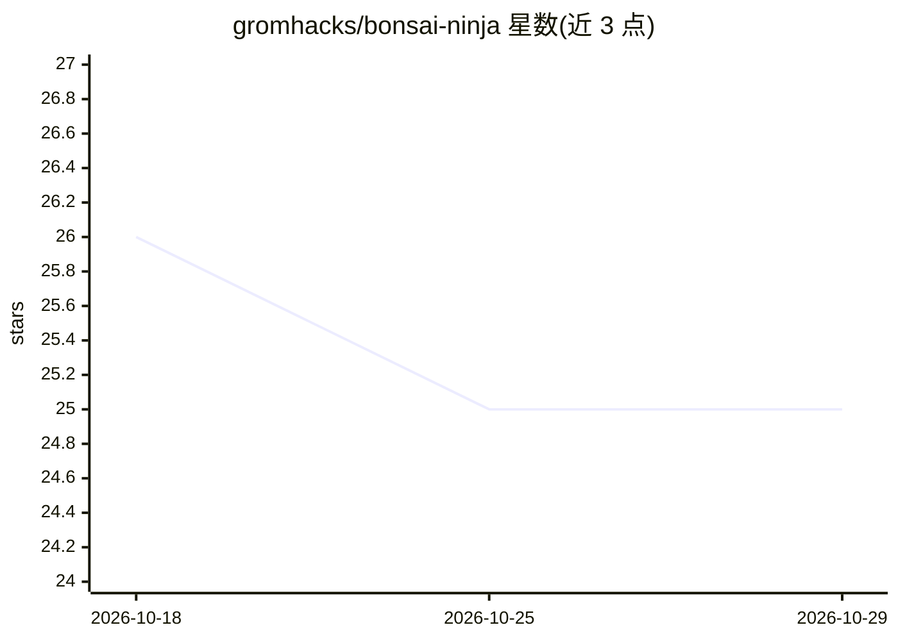

# gromhacks/bonsai-ninja

⭐ 25 · Rust · MIT · 推送 2026-10-25 · [GitHub](https://github.com/gromhacks/bonsai-ninja) · 组织维护

**本地静态分析与代码情报引擎：为开发者和 AI agent 提供编译器级代码事实**

基于 Tree-sitter 前端的本地代码情报与静态分析引擎（Rust 实现，crates.io 发布）。覆盖 20 种语言，将源码解析为类型化编译器 IR，构建符号解析、调用图、控制流与数据流事实，并用稀疏 IDG 不动点做源到汇的污点分析（如命令注入），输出 JSON/SARIF/HTML 报告及 GraphML/Cypher/NetworkX 图导出。面向需要小粒度代码上下文的 AI agent、安全审查人员与模型/agent 研究者；不需要托管服务或上传源码。项目自声明为早期阶段，静态分析对动态行为（反射、宏、动态分派）存在已知局限。

## 筛选速览

| 维度 | 判定 | 备注 |
|---|---|---|
| AI 角色 | `ai-ecosystem` | LLM/agent 周边工具 |
| 许可风险 | `permissive` | MIT |
| 部署形态 | `library` | 以包/库形式分发 |
| 模型依赖 | — | README 未给出锁定关系 |
| 硬件要求 | — | 无带数字的原话,不猜 |
| 安装摩擦 | `medium` | 含编译或系统依赖之一 |
| 成熟度 | `idea` | |

## 能力要点

- 20 种语言的 Tree-sitter 编译器前端与类型化 IR 管线
- 稀疏 IDG 污点不动点：源到汇可达性分析，无深度/文件/迭代上限
- 为 agent 提供符号级最小上下文切片（search/refs/calls/inspect-graph）
- JSON/GraphML/Cypher/NetworkX 结构化导出，含版本化 JSON Schema v14 契约

## 适用场景

- 为 AI agent 提供基于编译器证据的小粒度代码上下文，替代整文件投喂
- 对代码库做源到汇的安全污点分析并生成 SARIF/HTML 报告
- 导出调用图与数据流事实，用于检索、评测或代码推理实验
- 梳理陌生仓库的模块结构与跨文件行为链路

## 场景标签

`网络安全` · 领域:学习与行业

## 证据(README 行号)

> L42: bonsai-ninja is a local code-intelligence and static-analysis engine. It maps
> L80: tool-using agents; bonsai-ninja produces the evidence and does not train or

## 星数曲线

2026-10-18 26 → 2026-10-29 25（-1）

---
*卡片 v1 · prompt 1.4 · 生成 2026-10-27 · 置信度 high · 依据 README sha `19df79a8609f` · [字段定义](../../DATASET.md)*
