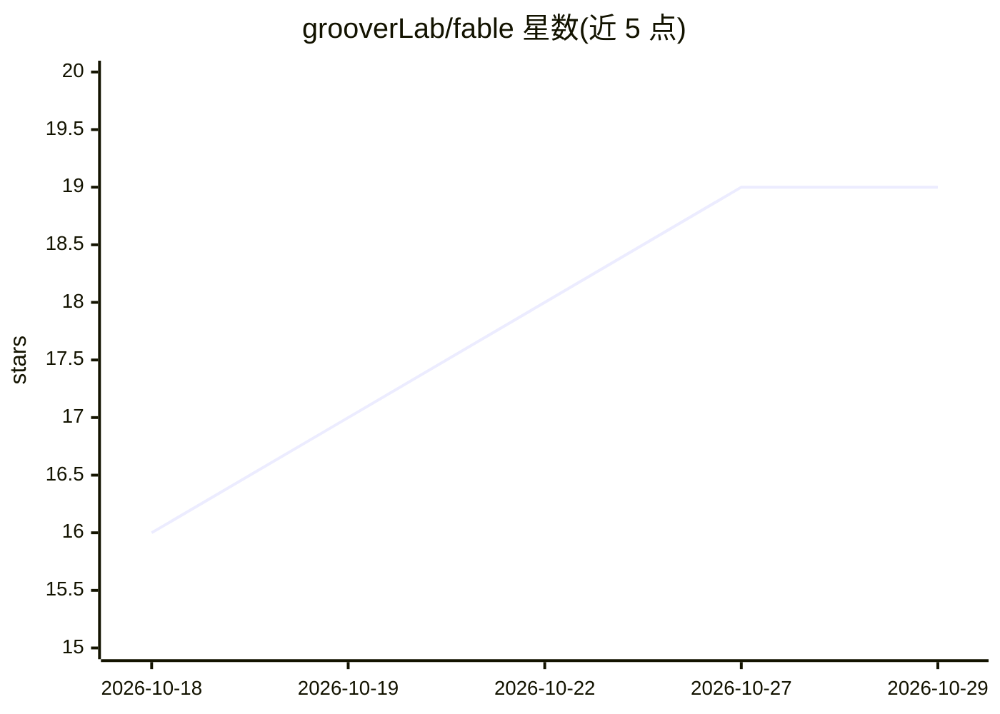

# grooverLab/fable

⭐ 19 · Python · MIT · 推送 2026-08-10 · [GitHub](https://github.com/grooverLab/fable) · [官网](https://glama.ai/mcp/servers/grooverLab/fable) · 个人维护

**Claude Code 会话记忆工具：索引全部历史，逐字召回与搜索**

面向 Claude Code 用户的本地会话记忆工具：通过 hooks 在压缩与清理前抓取转录，索引进本地 SQLite 的不可变 vault 与搜索映射，再经 MCP 服务器向 Claude 提供 search/recall/remember 工具。支持按项目/类型检索线程、拼装预算内上下文包、组合新会话、重建文件编辑历史（time-travel）、可逆修剪与 Memory Diff。标准库实现，无 API key，可选通过 Ollama 本地嵌入做语义检索。以 pipx 从 GitHub 安装 CLI。

## 筛选速览

| 维度 | 判定 | 备注 |
|---|---|---|
| AI 角色 | `ai-ecosystem` | LLM/agent 周边工具 |
| 许可风险 | `permissive` | MIT |
| 部署形态 | `None` |  |
| 模型依赖 | local-ok | 支持本地模型 |
| 硬件要求 | — | 无带数字的原话,不猜 |
| 安装摩擦 | `low` | 无编译、无系统依赖或容器化 |
| 成熟度 | — | 结构信号不足 |

## 能力要点

- 会话逐字节索引进本地 SQLite vault，30 天删除后仍可召回
- MCP 服务器向 Claude 提供 search/recall/remember 工具
- 文件编辑历史重建（time-travel）与可逆转录修剪/组合会话
- 标准库实现、无 API key，可选 Ollama 本地嵌入做语义搜索

## 适用场景

- 跨会话向 Claude 查询过去的架构决策并引用原话
- 定位某函数何时改坏并跳回当时的对话
- 压缩墙截断后续接调试过程，或瘦身大体积会话再恢复

## 场景标签

`Agent 记忆` · 领域:Agent 开发

## 证据(README 行号)

> L113: optional local embeddings via Ollama). Hooks run before Claude Code's
> L114: compaction and cleanup; an MCP server gives Claude search / recall /
> L115: remember tools. Measured on a real archive — 191,000 records, 6,000

## 星数曲线

2026-10-18 16 → 2026-10-29 19（+3）

---
*卡片 v1 · prompt 1.4 · 生成 2026-10-28 · 置信度 high · 依据 README sha `4130611605e5` · [字段定义](../../DATASET.md)*
