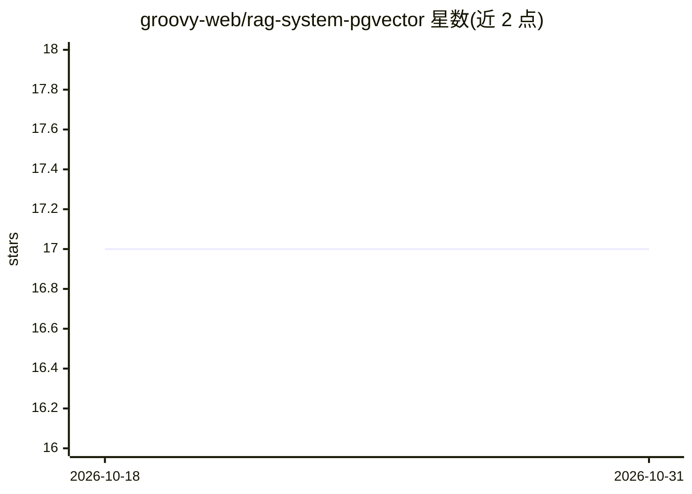

# groovy-web/rag-system-pgvector

⭐ 17 · MIT · 推送 2026-03-24 · [GitHub](https://github.com/groovy-web/rag-system-pgvector) · [官网](https://www.groovyweb.co) · 组织维护

**基于 PostgreSQL+pgvector 的 TypeScript RAG 系统实现**

以 PostgreSQL 与 pgvector 扩展为存储/检索层的 RAG 实现，提供语义搜索、语义+关键词混合搜索、文档分块策略、重排序、缓存、流式响应与对话记忆等模块（@rag-pgvector 系列包）。嵌入支持 OpenAI、Cohere 与本地模型。面向需要在自有数据上构建问答/搜索应用的开发者，提供迁移脚本、监控查询日志与连接池、熔断等生产部署组件。运行需 PostgreSQL 15+（含 pgvector 扩展）、Node.js 18+ 与嵌入模型 API key。

## 筛选速览

| 维度 | 判定 | 备注 |
|---|---|---|
| AI 角色 | `ai-ecosystem` | LLM/agent 周边工具 |
| 许可风险 | `permissive` | MIT |
| 部署形态 | `library` | 以包/库形式分发 |
| 模型依赖 | — | README 未给出锁定关系 |
| 硬件要求 | — | 无带数字的原话,不猜 |
| 安装摩擦 | `low` | 无编译、无系统依赖或容器化 |
| 成熟度 | — | 结构信号不足 |

## 能力要点

- pgvector 向量相似搜索与混合（语义+关键词）搜索
- 支持 OpenAI、Cohere 与本地模型多种嵌入
- 分块策略、重排序、缓存与流式响应
- 连接池、Redis 分布式缓存、熔断器等生产部署组件

## 适用场景

- 搭建基于自有文档的客服问答机器人
- 对企业知识库做语义/混合搜索
- 为代码文档构建检索问答系统

## 场景标签

`RAG` · 领域:知识与检索

## 证据(README 行号)

> L10: A complete, production-ready RAG (Retrieval-Augmented Generation) implementation using PostgreSQL with the pgvector
> L14: - **Semantic Search**: Vector similarity search with pgvector

## 星数曲线

2026-10-18 17 → 2026-10-31 17（+0）

---
*卡片 v1 · prompt 1.4 · 生成 2026-10-29 · 置信度 high · 依据 README sha `94e0b4c3305f` · [字段定义](../../DATASET.md)*
