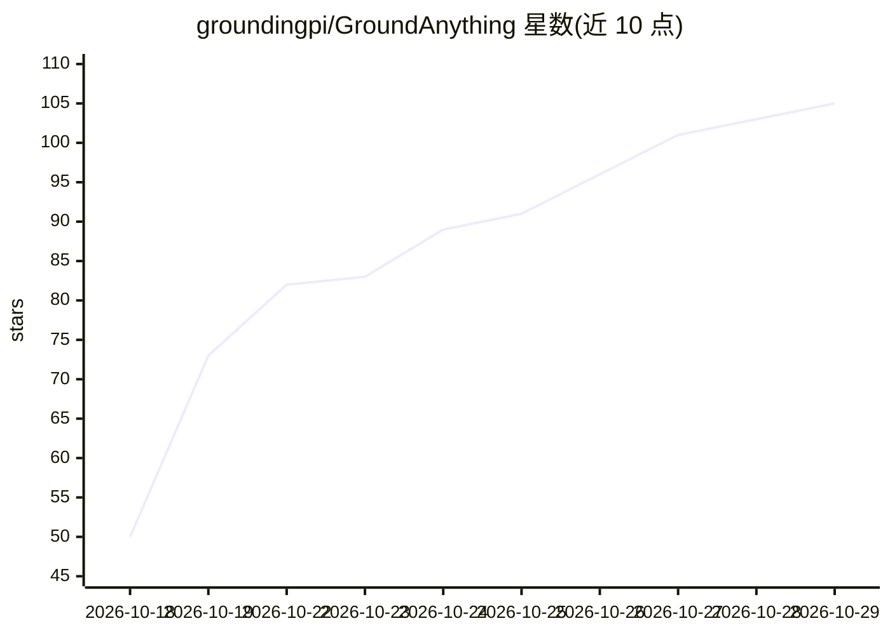

# groundingpi/GroundAnything

⭐ 105 · Python · Apache-2.0 · 推送 2026-10-14 · [GitHub](https://github.com/groundingpi/GroundAnything) · [官网](https://groundingpi.github.io/groundanything/) · 组织维护 · 中文 README

**4B 扩散视觉定位基础模型：统一多类 grounding 任务并并行解码加速**

GroundAnything 是 4B 参数的视觉定位（visual grounding）模型：给定一张图像与文本指令，输出框/点坐标，覆盖目标检测式定位、指代定位、OCR、文档版面、GUI 定位与视觉提示等任务，坐标采用 GAM 空间 token 协议（0-999 整数格）。主模型以熵引导扩散解码实现并行生成，可选自投机解码；另有自回归的 GroundAnything-VLM 检查点。提供定制 SGLang 与 vLLM（仅 VLM）两条部署路径，均暴露 OpenAI 兼容 API，附 Python 客户端与 JSONL 批量标注工具。面向 Linux x86_64 / Python 3.12，需 NVIDIA B300/B200/H200/H800 或 PPU 加速器。vLLM 适配器端到端加速器验证尚未完成。

## 筛选速览

| 维度 | 判定 | 备注 |
|---|---|---|
| AI 角色 | `ai-native` | 本体是模型或模型工具 |
| 许可风险 | `permissive` | Apache-2.0 |
| 部署形态 | `library` | 以包/库形式分发 |
| 模型依赖 | local-ok | 支持本地模型 |
| 硬件要求 | — | 无带数字的原话,不猜 |
| 安装摩擦 | `medium` | 含编译或系统依赖之一 |
| 成熟度 | `idea` | |

## 能力要点

- 扩散并行解码统一多类 grounding 任务，可选自投机解码
- 支持 bbox/point、OCR、文档版面、GUI 定位、视觉提示等任务
- OpenAI 兼容 API + Python 客户端 + JSONL 批量标注
- 模型权重发布于 Hugging Face 与 ModelScope

## 适用场景

- 按文本描述在图像中定位目标并输出框/点坐标
- 对图像集合做批量 grounding 标注
- GUI 自动化中的界面元素定位与 OCR 检测

## 场景标签

`目标检测` `OCR` `多模态` · 领域:感知与多模态

## 证据(README 行号)

> L47: - **Unlocking diffusion for broad visual grounding.** We introduce GroundAnything, a 4B foundation model that unifi
> L211: |Object / dense grounding|`Locate all the instances that match the following categories: car</c>person.`|
> L217: |GUI grounding|`Point to the UI element to click for the following instruction: open the settings menu.`|

## 星数曲线

2026-10-18 50 → 2026-10-29 105（+55）

---
*卡片 v1 · prompt 1.4 · 生成 2026-10-24 · 置信度 mid · 依据 README sha `267a33866d2b` · [字段定义](../../DATASET.md)*
