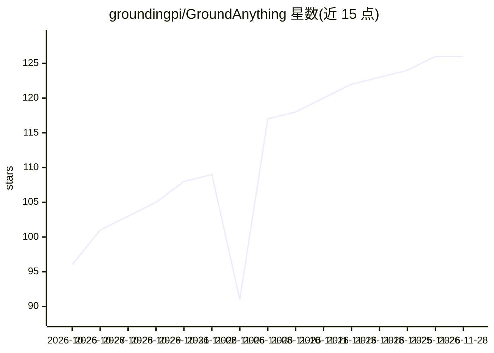

# groundingpi/GroundAnything

⭐ 126 · Python · Apache-2.0 · 推送 2026-10-31 · [GitHub](https://github.com/groundingpi/GroundAnything) · [官网](https://groundingpi.github.io/groundanything/) · 组织维护 · 中文 README

**4B 扩散视觉定位模型，输出框/点坐标与 OCR/GUI 定位**

GroundAnything 是一个 4B 参数的扩散式视觉定位模型，通过统一的 GAM 空间 token 协议输出 0–999 坐标网格上的框与点，任务覆盖指代定位、密集定位、OCR、文档版面、GUI 元素定位与视觉提示。提供 DLM（熵引导/自推测解码）与 VLM（自回归）两个权重；服务端用定制 SGLang，VLM 另有 vLLM Transformers 后端适配器；全部路由暴露 OpenAI 兼容 API，并附 Python 客户端、命令行示例与 JSONL 批量标注脚本。服务环境面向 Linux x86_64 / Python 3.12。

## 筛选速览

| 维度 | 判定 | 备注 |
|---|---|---|
| AI 角色 | `ai-native` | 本体是模型或模型工具 |
| 许可风险 | `permissive` | Apache-2.0 |
| 部署形态 | `library` | 以包/库形式分发 |
| 模型依赖 | local-ok | 支持本地模型 |
| 硬件要求 | — | 无带数字的原话,不猜 |
| 安装摩擦 | `medium` | 含编译或系统依赖之一 |
| 成熟度 | — | 结构信号不足 |

## 能力要点

- 统一多种 grounding 任务的并行解码，可选自推测解码
- OpenAI 兼容图像+文本 API，输出 0–999 坐标协议的结构化结果
- DLM 使用定制 SGLang 后端，VLM 提供 vLLM Transformers 后端适配器
- 提供 Python 客户端、predict 示例与可断点续跑的 JSONL 批量标注

## 适用场景

- 对图像集合批量标注指代框/点坐标作为检测数据
- 文档版面元素检测与 OCR 文本区域提取
- GUI 自动化中根据自然语言指令定位可点击元素
- 依据参考框寻找图中相似目标

## 场景标签

`目标检测` `OCR` · 领域:感知与多模态

## 证据(README 行号)

> L47: - **Unlocking diffusion for broad visual grounding.** We introduce GroundAnything, a 4B foundation model that unifi
> L94: All routes expose an **OpenAI-compatible image + text API** and produce structured visual grounding. Prompts cover 

## 星数曲线

2026-10-26 96 → 2026-11-28 126（+30）

---
*卡片 v1 · prompt 1.4 · 生成 2026-11-28 · 置信度 high · 依据 README sha `312adc75ff73` · [字段定义](../../DATASET.md)*
