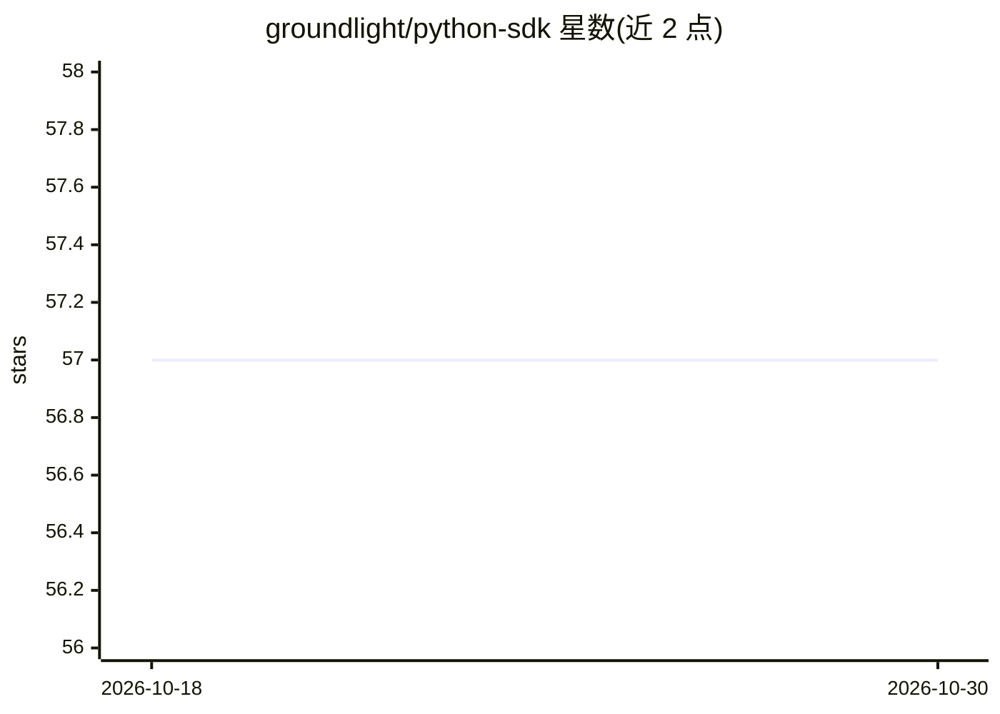

# groundlight/python-sdk

⭐ 57 · Python · MIT · 推送 2026-10-28 · [GitHub](https://github.com/groundlight/python-sdk) · [官网](https://code.groundlight.ai) · 组织维护

**访问 Groundlight 云端视觉问答 API 的 Python SDK**

Groundlight 公司的官方 Python SDK，用于接入其计算机视觉服务：用几行代码提交图片与自然语言问题，先由自动训练的 ML 模型分析，置信度不足时逐级升级至更重资源的分析直至实时人工审核，系统随使用自动学习、延迟逐步降低，无需先采集标注数据集。安装方式为 pip install groundlight，可通过 PyPI 与 GitHub 获取，配套代码文档与 Dashboard 登录入口。

## 筛选速览

| 维度 | 判定 | 备注 |
|---|---|---|
| AI 角色 | `ai-ecosystem` | LLM/agent 周边工具 |
| 许可风险 | `permissive` | MIT |
| 部署形态 | `library` | 以包/库形式分发 |
| 模型依赖 | — | README 未给出锁定关系 |
| 硬件要求 | — | 无带数字的原话,不猜 |
| 安装摩擦 | `low` | 无编译、无系统依赖或容器化 |
| 成熟度 | — | 结构信号不足 |

## 能力要点

- 自然语言定义的视觉检测，几行 Python 代码即可运行
- ML 模型置信度不足时逐级升级至人工审核
- 模型在用户数据上自动训练，无需预先标注数据集

## 适用场景

- 用自然语言提问快速搭建图片检测逻辑
- 冷启动阶段接受人工审核换取即时可用的视觉系统
- 在 Python 项目中集成 Groundlight 的视觉 API

## 场景标签

`目标检测` · 领域:感知与多模态

## 证据(README 行号)

> L1: # Groundlight Python SDK
> L22: Your images are first analyzed by machine learning (ML) models which are automatically trained on your data. If tho

## 星数曲线

2026-10-18 57 → 2026-10-30 57（+0）

---
*卡片 v1 · prompt 1.4 · 生成 2026-10-24 · 置信度 mid · 依据 README sha `0031f5d57d77` · [字段定义](../../DATASET.md)*
