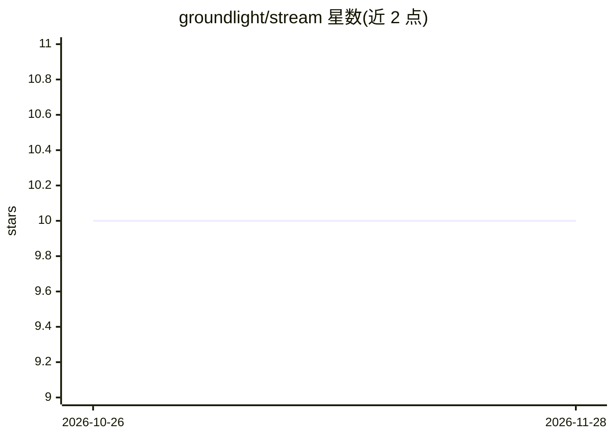

# groundlight/stream

⭐ 10 · Python · MIT · 推送 2026-07-21 · [GitHub](https://github.com/groundlight/stream) · [官网](https://hub.docker.com/r/groundlight/stream) · 组织维护

**读取视频流帧并发送至 Groundlight 检测器获取预测的容器**

容器化的 Python 应用，通过 Groundlight Python SDK 从视频文件、设备或流（本地 MP4、YouTube URL、RTSP 摄像头）中读取帧并发送给 Groundlight 检测器，返回预测与标签。使用需提供 Groundlight API token 和检测器 ID，即模型部署在 Groundlight 云端服务上。安装与运行均通过 Docker（docker pull / docker run），支持将本地目录挂载进容器处理本地视频文件。

## 筛选速览

| 维度 | 判定 | 备注 |
|---|---|---|
| AI 角色 | `ai-native` | 本体是模型或模型工具 |
| 许可风险 | `permissive` | MIT |
| 部署形态 | `self-host` | docker 或自建部署 |
| 模型依赖 | — | README 未给出锁定关系 |
| 硬件要求 | — | 无带数字的原话,不猜 |
| 安装摩擦 | `low` | 无编译、无系统依赖或容器化 |
| 成熟度 | — | 结构信号不足 |

## 能力要点

- 支持本地 MP4 文件、YouTube URL、RTSP 摄像头三类视频源
- 通过挂载主机目录方式处理本地视频文件
- 以 Docker 容器分发，docker pull 即可获取
- 帧预测结果由配置的 Groundlight 检测器提供

## 适用场景

- 把 RTSP 摄像头画面帧送入 Groundlight 检测器做预测
- 处理本地 MP4 视频文件并获取帧级预测标签
- 接入 YouTube 直播流进行帧分析

## 场景标签

`图像视频处理` `目标检测` · 领域:感知与多模态

## 证据(README 行号)

> L3: A containerized python application that uses the Groundlight Python SDK to
> L27: Start sending frames and getting predictions and labels using your own API token and detector ID:

## 星数曲线

2026-10-26 10 → 2026-11-28 10（+0）

---
*卡片 v1 · prompt 1.4 · 生成 2026-11-19 · 置信度 high · 依据 README sha `f4d60d6cee1e` · [字段定义](../../DATASET.md)*
