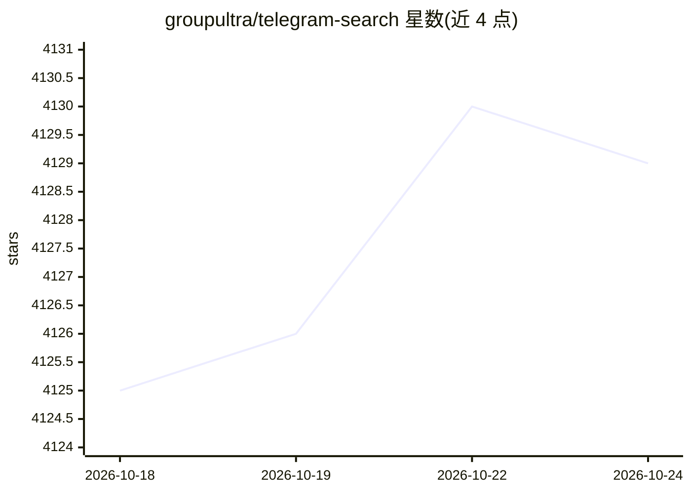

# groupultra/telegram-search

⭐ 4,131 · TypeScript · AGPL-3.0 · 推送 2026-10-17 · [GitHub](https://github.com/groupultra/telegram-search) · [官网](https://search.lingogram.app) · 组织维护 · 中文 README

**自托管工具：导出 Telegram 聊天记录并做模糊/语义搜索**

面向个人用户的消息备份与检索服务：通过 Telegram API 登录后导出聊天记录，存入 PGlite 或 PostgreSQL，消息导出时自动完成分词与向量嵌入，支持多语言模糊匹配、向量语义搜索与以文搜图；附带 Telegram Bot 搜索、未读消息摘要、RAG 问答等 AI 功能（AI Embedding 与 LLM 按账户在应用内配置）。部署方式包括 Homebrew CLI（macOS/Linux）、Docker Compose 与 Docker 镜像，也提供在线体验版；媒体可备份至 MinIO。

## 筛选速览

| 维度 | 判定 | 备注 |
|---|---|---|
| AI 角色 | `ai-enhanced` | 去掉 AI 部分产品仍成立 |
| 许可风险 | `viral` | AGPL-3.0 |
| 部署形态 | `self-host` | docker 或自建部署 |
| 模型依赖 | — | README 未给出锁定关系 |
| 硬件要求 | — | 无带数字的原话,不猜 |
| 安装摩擦 | `low` | 无编译、无系统依赖或容器化 |
| 成熟度 | — | 结构信号不足 |

## 能力要点

- 消息导出时自动分词与向量嵌入，支持多语言模糊匹配与语义搜索
- 图片 embedding 以文搜图，RAG 智能问答与未读消息摘要
- 兼容 PGlite 与 PostgreSQL，媒体可自动备份至 MinIO
- 提供本地优先的 TypeScript CLI（Agent 可组合命令）与 Docker 部署

## 适用场景

- 备份自己的 Telegram 聊天记录并跨语言检索历史消息
- 在海量消息中用语义模糊匹配定位某条信息
- 通过 AI 对未读消息生成摘要或基于历史上下文问答

## 场景标签

`语义搜索` `RAG` · 领域:知识与检索

## 证据(README 行号)

> L32: > 有了 Telegram Search，您可以便捷地备份并检索自己的 Telegram 消息。无论任何语言，强大的本地分词能力都能准确命中。
> L34: > 支持向量搜索，实现句子智能模糊匹配，查找信息更快速精准。
> L52: - [x] 融合模糊匹配与向量语义搜索，查找效率更高

## 星数曲线

2026-10-18 4,125 → 2026-10-24 4,129（+4）

---
*卡片 v1 · prompt 1.4 · 生成 2026-10-20 · 置信度 low · 依据 README sha `c4053e7a66b0` · [字段定义](../../DATASET.md)*
