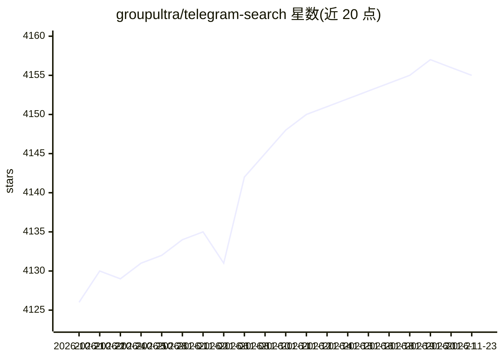

# groupultra/telegram-search

⭐ 4,155 · TypeScript · AGPL-3.0 · 推送 2026-11-19 · [GitHub](https://github.com/groupultra/telegram-search) · [官网](https://search.lingogram.app) · 组织维护 · 中文 README

**导出并模糊检索 Telegram 聊天记录，支持向量搜索与 AI 摘要**

一款本地化检索 Telegram 聊天记录的工具：通过 Takeout 批量同步历史消息并在本地分词建索引，使中文等非空格分词语言可按词命中；提供向量语义搜索、按月 JSONL 导出、Telegram Bot 搜索、未读消息 AI 摘要与 RAG 问答。提供 tgs CLI 与可选网页界面（docker 部署），CLI 支持 --json 结构化输出以供 AI Agent 调用。数据库支持 postgres（pgvector）或嵌入式 pglite，媒体可备份至 MinIO。

## 筛选速览

| 维度 | 判定 | 备注 |
|---|---|---|
| AI 角色 | `ai-enhanced` | 去掉 AI 部分产品仍成立 |
| 许可风险 | `viral` | AGPL-3.0 |
| 部署形态 | `self-host` | docker 或自建部署 |
| 模型依赖 | — | README 未给出锁定关系 |
| 硬件要求 | — | 无带数字的原话,不猜 |
| 安装摩擦 | `low` | 无编译、无系统依赖或容器化 |
| 成熟度 | — | 结构信号不足 |

## 能力要点

- 本地分词索引，中文按词命中；支持向量语义检索与以文搜图
- Takeout 批量同步 + daemon 实时保存新消息、编辑和删除
- CLI --json 输出结构化结果，可被 Claude Code、Codex 等 Agent 调用
- brew 安装 CLI，docker 部署网页界面

## 适用场景

- 备份并检索自己的 Telegram 中文聊天记录
- 按句子语义模糊查找历史消息
- 把本地聊天记录检索能力交给 AI Agent 使用
- 按月导出消息为带校验的 JSONL 归档

## 场景标签

`RAG` `语义搜索` · 领域:知识与检索

## 证据(README 行号)

> L32: > 有了 Telegram Search，您可以备份并检索自己的 Telegram 消息。消息在本地分词后建立索引，中文等不以空格分词的语言也能按词命中。
> L34: > 支持向量搜索，按句子语义模糊匹配。还支持未读消息 AI 摘要、AI 助手对话等功能。
> L103: - [x] 分词检索；服务端另支持向量语义检索和以文搜图

## 星数曲线

2026-10-21 4,126 → 2026-11-23 4,155（+29）

---
*卡片 v1 · prompt 1.4 · 生成 2026-11-23 · 置信度 mid · 依据 README sha `6c74dc130c2f` · [字段定义](../../DATASET.md)*
