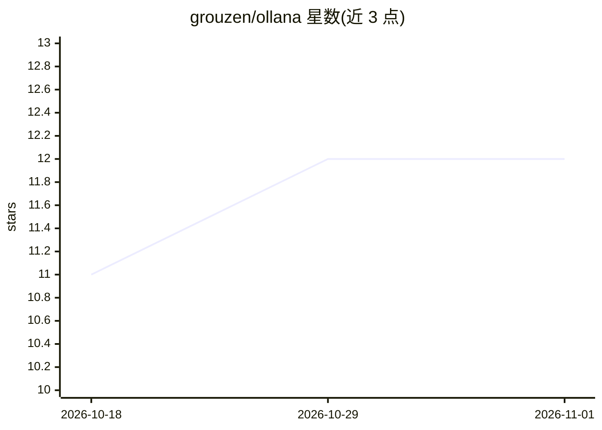

# grouzen/ollana

⭐ 12 · Rust · MIT · 推送 2026-10-30 · [GitHub](https://github.com/grouzen/ollana) · 个人维护

**局域网自动发现 Ollama 服务器的 Rust 代理工具**

用 Rust 编写的本地代理：通过 UDP 广播自动发现同网段的 Ollama 服务器，客户端无需修改配置或指定 IP 即可像本地一样使用远程 Ollama 实例。流量以自签名 X.509 证书的 TLS 加密，访问控制通过双向 Device ID 授权实现。提供 Linux/macOS 预编译二进制、crates.io 安装与源码编译三种安装方式，另含 Gentoo overlay 途径。自动根据本机是否运行 Ollama 决定客户端或服务端模式。

## 筛选速览

| 维度 | 判定 | 备注 |
|---|---|---|
| AI 角色 | `ai-ecosystem` | LLM/agent 周边工具 |
| 许可风险 | `permissive` | MIT |
| 部署形态 | `desktop` | 安装包/桌面程序 |
| 模型依赖 | local-ok | 支持本地模型 |
| 硬件要求 | — | 无带数字的原话,不猜 |
| 安装摩擦 | `medium` | 含编译或系统依赖之一 |
| 成熟度 | — | 结构信号不足 |

## 能力要点

- UDP 广播自动发现局域网内 Ollama 服务器
- 以自签名 X.509 证书实现 TLS 加密
- 双向 Device ID 授权的设备管理机制
- 客户端无需修改配置即可连接远程 Ollama

## 适用场景

- 在家中或办公室的任意设备上使用同一台 Ollama 服务器
- 局域网内共享本地大模型服务而无需配置反向代理
- 通过设备 ID 白名单控制谁可访问我的 Ollama 服务器

## 场景标签

 · 领域:LLM 基础设施/网络代理

## 证据(README 行号)

> L3: Auto-discover your Ollama server on your local network with hassle-free ease.
> L11: - **No need to specify the IP address of an Ollama server** - Automatically discovers Ollama servers on your local 
> L96: It automatically detects the mode (client or server) to run in by checking whether an Ollama server is running on y

## 星数曲线

2026-10-18 11 → 2026-11-01 12（+1）

---
*卡片 v1 · prompt 1.4 · 生成 2026-11-01 · 置信度 high · 依据 README sha `658c8c76111a` · [字段定义](../../DATASET.md)*
