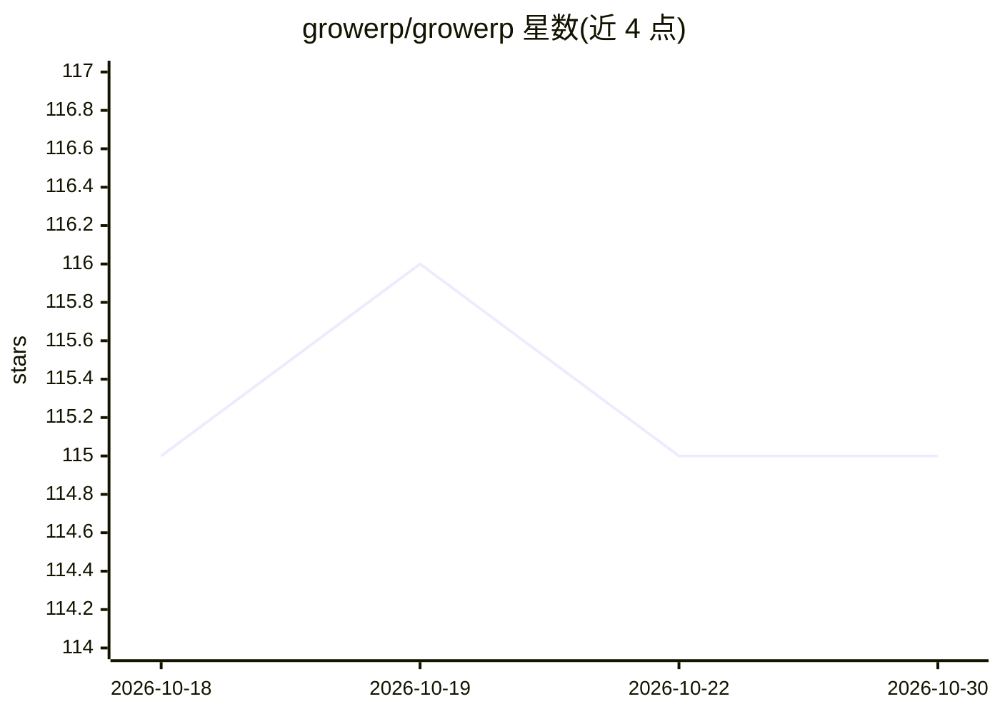

# growerp/growerp

⭐ 115 · Dart · Apache-2.0 · 推送 2026-10-29 · [GitHub](https://github.com/growerp/growerp) · [官网](https://www.growerp.com) · 组织维护

**Flutter+Moqui 的模块化开源 ERP，含 AI 助手/Agent 治理**

多平台（Web/Linux/Windows/macOS/Android/iOS）模块化 ERP，前端为 Flutter 构建块（目录、库存、订单会计、HR 等 growerp_* 包），后端为 Moqui 框架与 REST API。按行业提供 Admin、Hotel、Freelance、Marketing、Rental、Agents、Support 等应用。AI 为其中功能：基于 Google Gemini 的发票扫描数据提取、AI Agent 编排与控制中心（moqui-adk）、MCP 协议集成（moqui-mcp）、LLM API key 管理与 token 限额、AI 评分与落地页生成。本地安装需 OpenJDK 21、Flutter、Chrome，通过 git clone 子模块、gradle 构建；也提供 Docker 与 Snap 部署及官网试用。

## 筛选速览

| 维度 | 判定 | 备注 |
|---|---|---|
| AI 角色 | `ai-enhanced` | 去掉 AI 部分产品仍成立 |
| 许可风险 | `permissive` | Apache-2.0 |
| 部署形态 | `None` |  |
| 模型依赖 | — | README 未给出锁定关系 |
| 硬件要求 | — | 无带数字的原话,不猜 |
| 安装摩擦 | `medium` | 含编译或系统依赖之一 |
| 成熟度 | — | 结构信号不足 |

## 能力要点

- Flutter 前端构建块 + Moqui 后端的模块化 ERP 架构，按行业拆分多个应用
- Agent Control Center（moqui-adk）做多 Agent 编排、工具范围与治理，含审批与操作审计
- 基于 Gemini 的发票扫描数据提取；LLM API key 架构与 token 限额
- moqui-mcp 提供 Model Context Protocol 外部 AI 工具集成

## 适用场景

- 中小企业或企业按需组合模块搭建 ERP（订单、库存、会计、HR 等）
- 酒店、自由职业、租赁等行业的预构建应用开箱试用
- 在 ERP 内用 AI Agent 执行任务并对其操作做审批与审计
- 扫描发票并用 AI 提取数据入账

## 场景标签

 · 领域:企业软件/ERP

## 证据(README 行号)

> L54: - **🤖 Invoice Scan & AI Extraction** - Invoice scanning and AI-powered data extraction with Google Gemini
> L139: - **moqui-adk** - Agent Development Kit for multi-agent orchestration and governance
> L227: - AI Agent orchestration and control center

## 星数曲线

2026-10-18 115 → 2026-10-30 115（+0）

---
*卡片 v1 · prompt 1.4 · 生成 2026-10-23 · 置信度 high · 依据 README sha `0af9c3705137` · [字段定义](../../DATASET.md)*
