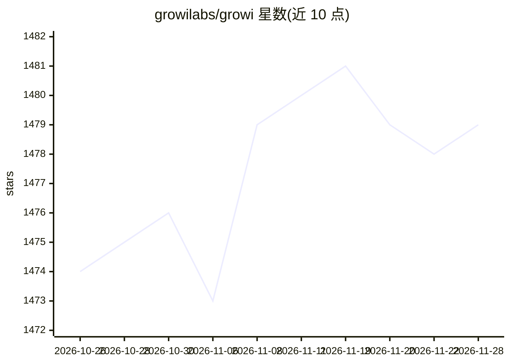

# growilabs/growi

⭐ 1,479 · TypeScript · MIT · 推送 2026-11-27 · [GitHub](https://github.com/growilabs/growi) · [官网](https://growi.org) · 组织维护

**面向团队的 Markdown 协作 wiki 软件**

GROWI 是一款基于 Markdown 的团队协作 wiki 软件，支持创建层级页面、多人同时编辑，认证方面支持 LDAP/Active Directory、OAuth 与 SAML SSO，可集成 Slack/Mattermost 与 IFTTT，并通过 npm 或 GitHub 提供插件扩展机制。部署提供 docker-compose、Helm Chart（实验性）及 Ubuntu/CentOS 本地安装文档；开发依赖 Node.js v24.x、pnpm、MongoDB v6.x/v8.x，全文检索需可选安装 ElasticSearch 及日语分词等插件。README 未描述 AI 相关功能细节。

## 筛选速览

| 维度 | 判定 | 备注 |
|---|---|---|
| AI 角色 | `ai-enhanced` | 去掉 AI 部分产品仍成立 |
| 许可风险 | `permissive` | MIT |
| 部署形态 | `self-host` | docker 或自建部署 |
| 模型依赖 | — | README 未给出锁定关系 |
| 硬件要求 | — | 无带数字的原话,不猜 |
| 安装摩擦 | `low` | 无编译、无系统依赖或容器化 |
| 成熟度 | — | 结构信号不足 |

## 能力要点

- Markdown 层级页面创建与多人同时编辑
- LDAP/Active Directory、OAuth 认证与 SAML SSO
- npm/GitHub 插件扩展机制
- docker-compose 与 Helm Chart 部署支持

## 适用场景

- 团队用 Markdown 搭建内部知识库
- 需要与企业 LDAP/SSO 认证体系对接的 wiki 部署
- 通过 docker-compose 在自托管服务器上运行多人协作文档站点

## 场景标签

`知识库管理` · 领域:知识与检索

## 证据(README 行号)

> L12: # GROWI
> L26: - **Features**
> L27:  - Create hierarchical pages with markdown -> Try GROWI on the demo site

## 星数曲线

2026-10-26 1,474 → 2026-11-28 1,479（+5）

---
*卡片 v1 · prompt 1.4 · 生成 2026-11-23 · 置信度 mid · 依据 README sha `eb0f4a20efff` · [字段定义](../../DATASET.md)*
